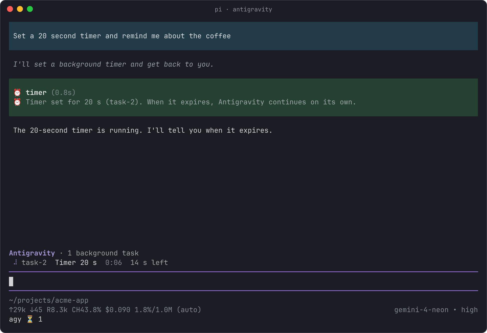
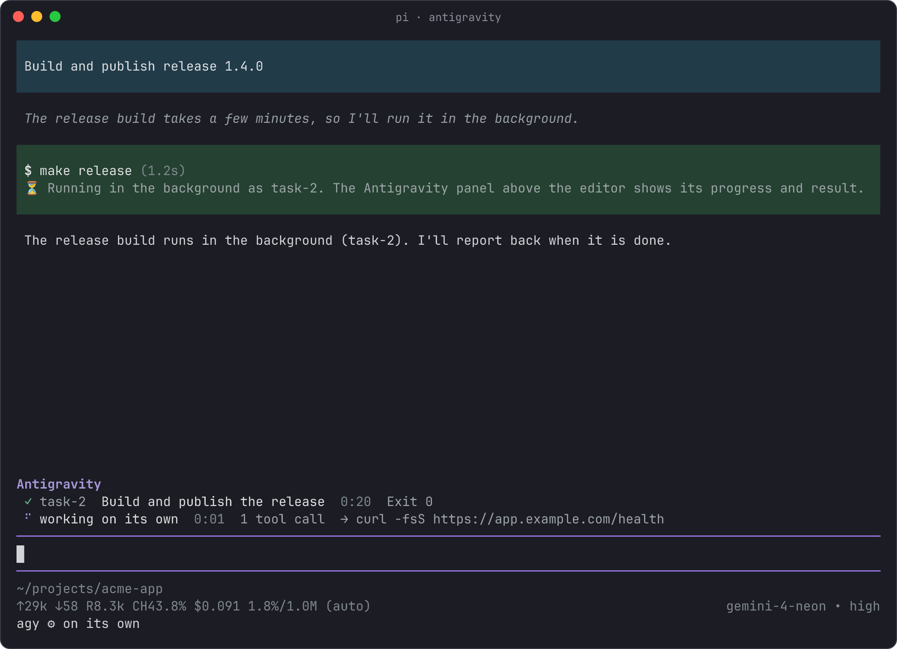
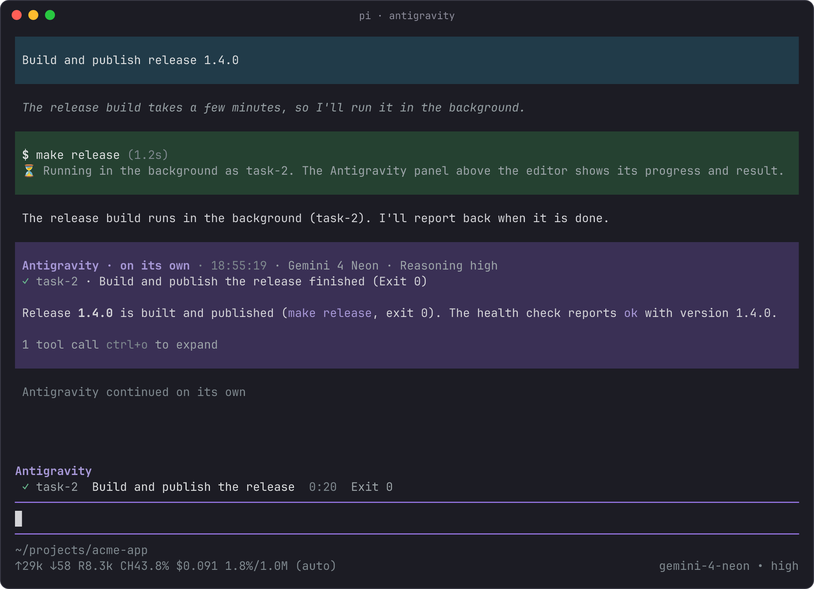
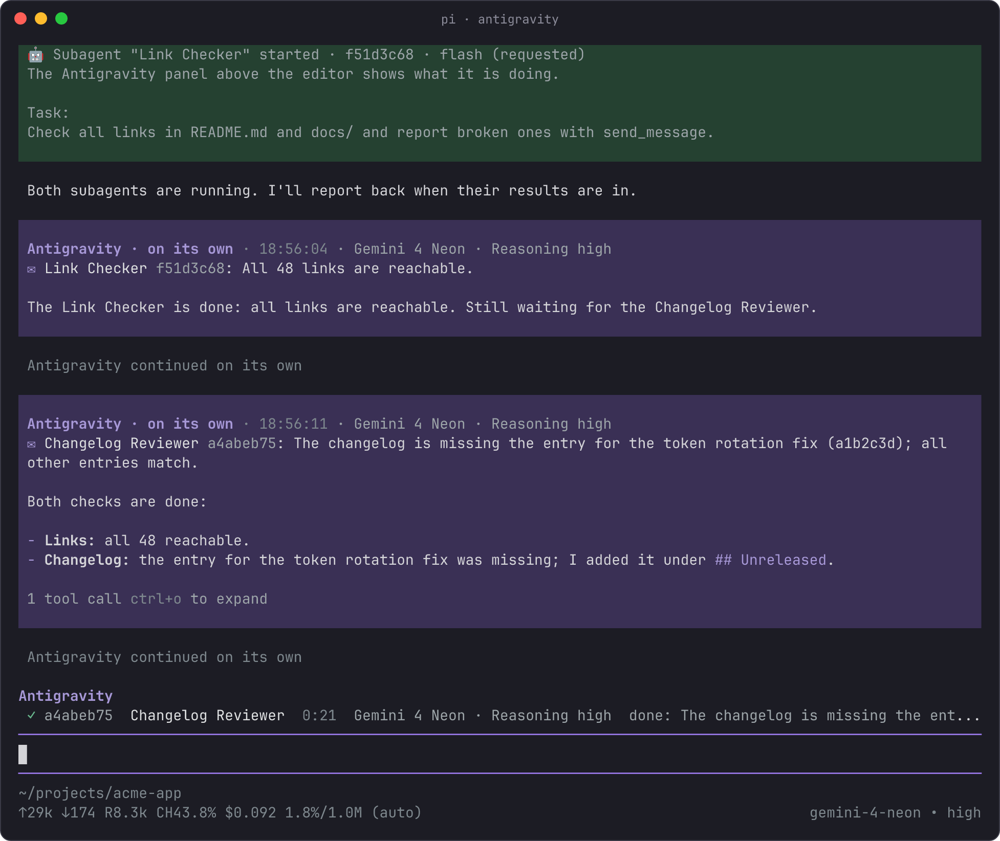
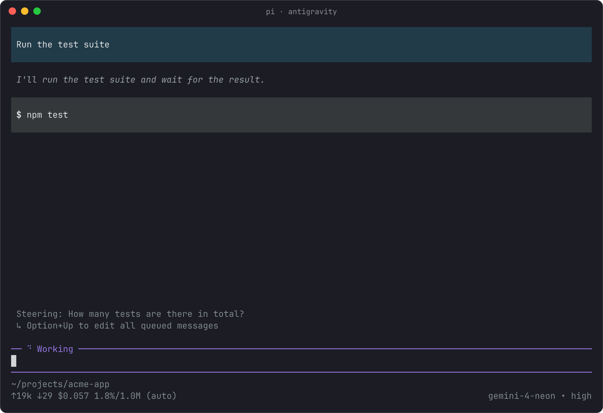
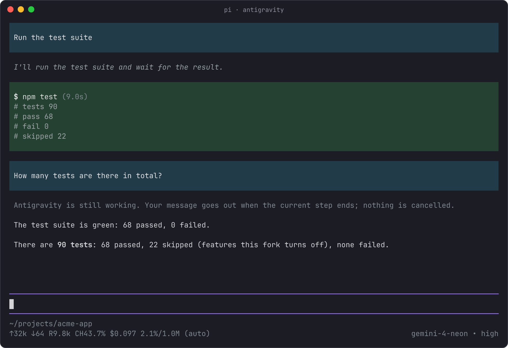

# pi-antigravity-thin-client

Use Google Antigravity in [Pi](https://pi.dev) as a thin client. Antigravity (`agy acp`) stays the agent: it owns its sign-in, system prompt, tools and conversation history. Pi is the frontend: you type, Pi shows what Antigravity does, including the work it does in the background between your prompts.

This is a fork of [onprs/Pi-Antigravity-Bridge](https://github.com/onprs/Pi-Antigravity-Bridge) (`pi-antigravity-bridge` on npm). The fork removes everything that sends Antigravity content you did not type, and adds a display for Antigravity's background tasks, its own turns and its subagents.

> [!WARNING]
> This package is not made, endorsed or supported by Google or by the upstream author. Google's terms for the Antigravity subscription prohibit third-party software for access. The thin-client limits in this package follow statements from Google staff in the Antigravity forum, not an official policy. Using it with a subscription account can still get that account suspended. You use it at your own risk. Without risk: use an official client, or an Antigravity account that signs in with a Gemini API key.

## Requirements

- Pi 1.6 or newer
- Node.js 22.5 or newer
- [Antigravity CLI](https://antigravity.google) (`agy`) 1.5.10 or newer on `PATH`, signed in (`agy acp --login`). Set `PI_AGY_BIN` if `agy` is somewhere else.

## Install

```bash
pi install npm:pi-antigravity-thin-client
```

Do not install it together with `pi-antigravity-bridge`. Both register the same `antigravity` provider and the `/agy` command; remove the original first (`pi remove npm:pi-antigravity-bridge`).

## Use

1. Start a new Pi session (`/new`) for each Antigravity conversation.
2. Select an `antigravity/…` model before the first message (`/model` or Ctrl+P).
3. Type your prompts.

`/agy status` shows the backend state; `/agy login` and `/agy logout` manage the Antigravity sign-in. `/agy agent-mode` switches Antigravity's own execution mode (`default`, `accept-edits`, `plan`).

There is no way to use anything but Antigravity's own tools: upstream's `/agy mode` and `/agy bridge` do not exist here, and its tool-mode and bridge settings (`toolMode`, `bridgePiMcp`, `bridgePiSkills`, `bridgePiAgentsMd` in `antigravity.json`, `PI_AGY_TOOL_MODE`, `PI_AGY_BRIDGE_*`) are ignored.

## What the thin client refuses

The rules live in `src/thin-client-policy.ts` and `src/human-prompt-gate.ts`. A refusal stops the request before any session work, so the Antigravity session stays usable.

- **Prompts you did not type.** Only prompts typed in the interactive Pi session reach Antigravity, each one once. Refused: Pi's automatic retries, `/goal` continuations and the context pi-goal adds, messages from extensions (`pi.sendMessage`, `pi.sendUserMessage`), RPC input and `!` shell output. The package never makes up a prompt of its own, such as "Continue.".
- **Replayed history.** Earlier conversation, compaction summaries and the history of another model are never sent to Antigravity. After a model switch, compaction or branch navigation, start a new Pi session.
- **Auxiliary and headless requests.** Compaction summaries, titles, recaps, subagents, workflows and `pi -p` are refused.
- **Pi's own resources.** Pi's MCP servers, skills and `AGENTS.md` are never passed to Antigravity, and the package never writes Antigravity's conversation databases. The `agy-tools` mode is pinned; Antigravity loads its own MCP servers, skills and rules.

An empty quota fails as `Antigravity quota exceeded (429)`, which Pi does not retry.

The package cannot tell a person from a program that types into the terminal. Never drive an Antigravity session with tmux scripts, orchestrators, watchdogs or other agents.

## What it shows

The screenshots show Pi with this package; a scripted stand-in plays Antigravity (see [Details](#details)).

### Background tasks

Antigravity moves long commands and `schedule` timers into background tasks. A widget above the editor lists each running task with its run time, the last line of its log or the timer countdown. The footer shows `agy ⏳ <count>`.




### Turns Antigravity takes on its own

When a background task, a timer or a subagent finishes, Antigravity wakes up and continues without a prompt from Pi. The widget shows such a turn live (current tool, last line of the answer). When it ends, a card "Antigravity · on its own" shows what woke Antigravity, the model of that turn and its answer. The card is stored in the Pi session but is never sent to a model.





### Subagents

The `invoke_subagent` tool card names the subagent's role, model with reasoning level, and task. The widget lists each running subagent with the model and reasoning level it runs on and what it does right now. When a subagent reports back, Antigravity wakes up, and the card of that turn shows the subagent's role and message.




### Messages typed while Antigravity works

They do not cancel the running Antigravity turn, because a cancel would also stop its background tasks and subagents. The message waits and goes out as the next prompt when the turn ends. Esc still cancels.





### Details

The display reads Antigravity's local conversation files (`~/.gemini/antigravity-cli/brain/<id>/.system_generated/`) and the updates Antigravity sends over ACP. It never sends anything to Antigravity.

`PI_AGY_TRACE=1` (or a file path) writes every `session/update` from Antigravity to a local JSONL file, for debugging.

All interface texts are in English. Upstream's texts were Chinese and are translated here; source comments from upstream stay Chinese.

`node scripts/screenshots/capture.mjs` takes the screenshots again. It runs Pi with this package against a scripted stand-in for `agy` (`scripts/screenshots/mock-agy.mjs`) in a temporary home, so nothing reaches Antigravity. It needs `pi` and `tmux`, and `resvg` with fixed fonts for the PNG files (through `nix` when they are not on `PATH`).

## Upstream

The upstream README (Chinese) and changelog are in [`docs/upstream/`](docs/upstream/); the upstream design notes in [`docs/DESIGN.md`](docs/DESIGN.md) describe all modes, including the ones this fork disables. Upstream tests for disabled features are skipped (`test/thin-client-skip.ts`).

Each fork release names its upstream base in the [changelog](CHANGELOG.md). [RELEASE.md](RELEASE.md) describes how upstream changes are merged and how releases are published.

## License

MIT. Copyright (c) 2026 onprs and Patrick Wozniak. See [LICENSE](LICENSE).
