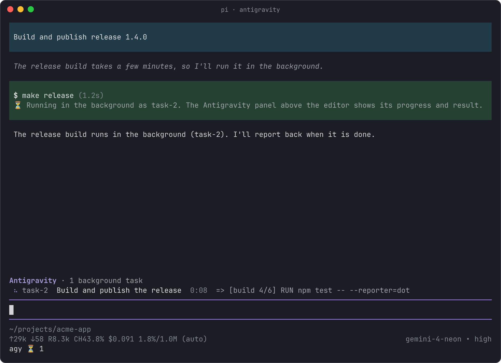
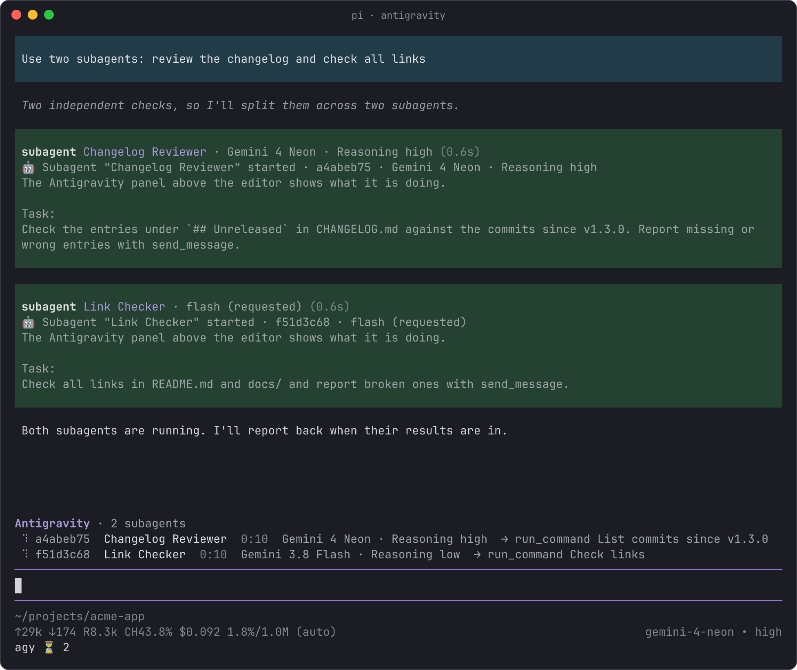

# pi-antigravity-thin-client

Use Google Antigravity in [Pi](https://pi.dev) as a thin client. Antigravity (`agy acp`) stays the agent: it owns its sign-in, system prompt, tools and conversation history. Pi is the frontend: you type, Pi shows what Antigravity does, including the work it does in the background between your prompts.

This is a fork of [onprs/Pi-Antigravity-Bridge](https://github.com/onprs/Pi-Antigravity-Bridge) (`pi-antigravity-bridge` on npm). The fork removes everything that sends Antigravity content you did not type, and adds a display for Antigravity's background tasks, its own turns and its subagents.

> [!WARNING]
> This package is not made, endorsed or supported by Google or by the upstream author. It aims to stay within what Google allows for a subscription sign-in (see [Staying within what Google allows](#staying-within-what-google-allows)), but Google has not confirmed that boundary in its terms or docs. Using it with a subscription account can still get that account suspended. You use it at your own risk.

## Staying within what Google allows

The goal of this package is to use an Antigravity subscription sign-in (`oauth-personal`, Google AI Pro or Ultra) only the way Google allows, and to give up any feature that does not fit.

### The boundary it follows

Replies in Google's AI Developers Forum describe when a third-party client may run `agy acp` with a subscription sign-in ([2 November](https://discuss.ai.google.dev/t/conflicting-guidance-on-using-t3-code-with-personal-google-ai-subscriptions/197131/3), [19 November](https://discuss.ai.google.dev/t/a-question-regarding-the-usage-limitations-of-antigravity-acp/202556/2) and [20 November 2026](https://discuss.ai.google.dev/t/tos-clarification-is-opencode-antigravity-acp-official-agy-acp-in-opencode-permitted-under-the-antigravity-terms-of-service/202970/2)). The reply of 20 November:

> Launching unmodified `agy acp` interactively is permitted only in a thin client where Antigravity is the agent—meaning the human sends raw prompts directly to `agy acp` and Antigravity owns its sign-in, system prompt, tools, and session history. Wrapping `agy acp` inside an outer third-party coding agent harness (such as OpenCode) that injects system instructions, serialized tool definitions, replayed cross-model context, or automated loops is not permitted on `oauth-personal`—even without extracting OAuth tokens—and risks automated enforcement or suspension.

### How the package keeps to it

| Condition | What the package does |
| --- | --- |
| Unmodified `agy acp` with Antigravity's own sign-in | Starts the installed `agy acp`. Sign-in runs in `agy` itself (`/agy login` starts `agy acp --login`); the package never reads, stores or forwards OAuth tokens. |
| Antigravity owns the system prompt | Sends no system prompt, no workspace context, no `AGENTS.md` and no skills from Pi. A prompt is the text (and images) you typed. |
| Antigravity owns the tools | The `agy-tools` mode is pinned: Antigravity works with its own tools, and Pi shows the calls and asks you for approvals. Pi's tools and MCP servers are never passed to it; Antigravity loads its own MCP servers. There is no `/agy mode` or `/agy bridge`, and the matching settings are ignored. |
| Antigravity owns the session history | Never replays earlier conversation, compaction summaries or another model's history, and never writes Antigravity's conversation databases. To continue a conversation, Pi reopens it in `agy` with ACP `session/resume`, which [the ACP docs](https://antigravity.google/docs/ide/extensions/acp#sessions) describe as "reopens the conversation without replaying its history". After a model switch, compaction or branch navigation, start a new Pi session. |
| The human sends the prompts; no automated loops | Only prompts typed in the interactive Pi session reach Antigravity, each one once. Refused before any session work: Pi's automatic retries, `/goal` continuations and the context pi-goal adds, messages from extensions (`pi.sendMessage`, `pi.sendUserMessage`), RPC input, `!` shell output, compaction summaries, titles, recaps, subagents, workflows and `pi -p`. The package never makes up a prompt of its own, such as "Continue.". An empty quota fails as `Antigravity quota exceeded (429)`, which Pi does not retry. |

Turns that Antigravity takes on its own (after a background task, a timer or a subagent) are Antigravity's own feature. The package only shows them; the display reads Antigravity's local files and sends nothing.

The rules live in `src/thin-client-policy.ts` and `src/human-prompt-gate.ts`. `test/thin-client-policy.test.ts`, `test/human-prompt-gate.test.ts` and the thin-client cases in `test/turn-coordinator-e2e.test.ts` check them in CI on every change.

### What it cannot promise

- **The boundary is not in Google's terms or docs.** Section 6 of the [Antigravity Terms](https://antigravity.google/terms) says: "Using third party software, tools, or services to access the Service (e.g. using OpenClaw with Antigravity OAuth) is a breach of this Agreement." The [FAQ](https://antigravity.google/docs/faq#why-cant-i-use-third-party-software-such-as-claude-code-openclaw-or-opencode-with-my-antigravity-login) calls third-party software with the Antigravity login a violation and recommends an API key for third-party coding agents. The [ACP docs](https://antigravity.google/docs/ide/extensions/acp) say: "Any ACP client can launch Antigravity CLI." The forum replies above are the most specific description there is, but their author is not marked as Google staff, and a [question of 23 November 2026](https://discuss.ai.google.dev/t/tos-clarification-is-opencode-antigravity-acp-official-agy-acp-in-opencode-permitted-under-the-antigravity-terms-of-service/202970/5) about where the boundary is written down has no answer yet.
- **Google decides.** Google can read its terms differently or change them, and may suspend Antigravity and Gemini CLI access for a breach.
- **The package cannot tell a person from a program.** A program that types into the terminal looks like you. Never drive an Antigravity session with tmux scripts, orchestrators, watchdogs or other agents.
- **Without this risk:** use Antigravity itself or an ACP client Google names, such as Zed, JetBrains IDEs, Android Studio or Xcode. For agent harnesses, Google points to a Gemini API key or Google Cloud sign-in ([ACP authentication](https://antigravity.google/docs/ide/extensions/acp#authentication)).

If Google publishes a different boundary, the package will follow it. Please open an issue with the source.

## Requirements

- Pi 1.6 or newer
- Node.js 22.5 or newer
- [Antigravity CLI](https://antigravity.google) (`agy`) 1.5.10 or newer on `PATH`, signed in (`agy acp --login`). Set `PI_AGY_BIN` if `agy` is somewhere else.

## Install

```bash
pi install npm:pi-antigravity-thin-client
```

Do not install it together with `pi-antigravity-bridge`. Both register the same `antigravity` provider and the `/agy` command; remove the original first (`pi remove npm:pi-antigravity-bridge`).

## Use

1. Start a new Pi session (`/new`) for each Antigravity conversation.
2. Select an `antigravity/…` model before the first message (`/model` or Ctrl+P).
3. Type your prompts.

### Continue a conversation

- **A Pi session:** open it again (`/resume`, `pi --continue`) and type the next prompt. Pi reopens the same Antigravity conversation with `session/resume` and sends only what you typed; nothing goes out before that. Turns Antigravity took on its own after your last prompt stay part of the conversation.
- **A conversation from `agy` or another ACP client:** `/agy sessions` lists Antigravity's conversations for the current directory. The one you pick opens in a new Pi session: `session/load` shows its history in Pi, and your next prompt continues it with `session/resume`.

Continuing works only from the latest message. If the Antigravity conversation got further prompts after the point Pi shows (from a later message on another branch after `/tree`, a forked Pi session or another client), the package refuses the prompt: Antigravity cannot go back without rewriting its history. If the conversation is gone, it refuses too, because the only way out would be to replay Pi's history.

`/agy status` shows the backend state; `/agy login` and `/agy logout` manage the Antigravity sign-in. `/agy agent-mode` switches Antigravity's own execution mode (`default`, `accept-edits`, `plan`, `auto`).

There is no way to use anything but Antigravity's own tools: upstream's `/agy mode` and `/agy bridge` do not exist here, and its tool-mode and bridge settings (`toolMode`, `bridgePiMcp`, `bridgePiSkills`, `bridgePiAgentsMd` in `antigravity.json`, `PI_AGY_TOOL_MODE`, `PI_AGY_BRIDGE_*`) are ignored.

## What it shows

The screenshots show Pi with this package; a scripted stand-in plays Antigravity (see [Details](#details)).

### Background tasks

Antigravity moves long commands and `schedule` timers into background tasks. A widget above the editor lists each running task with its run time, the last line of its log or the timer countdown. The footer shows `agy ⏳ <count>`.




### Turns Antigravity takes on its own

When a background task, a timer or a subagent finishes, Antigravity wakes up and continues without a prompt from Pi. The widget shows such a turn live (current tool, last line of the answer). When it ends, a card "Antigravity · on its own" shows what woke Antigravity, the model of that turn and its tool calls; the answer follows below the card like any other answer. The card is stored in the Pi session but is never sent to a model.


### Subagents

The `invoke_subagent` tool card names the subagent's role, model with reasoning level, and task. The widget lists each running subagent with the model and reasoning level it runs on and what it does right now. When a subagent reports back, Antigravity wakes up, and the card of that turn shows the subagent's role and message.




### Messages typed while Antigravity works

They do not cancel the running Antigravity turn, because a cancel would also stop its background tasks and subagents. The message waits and goes out as the next prompt when the turn ends. Esc still cancels.


### Details

The display reads Antigravity's local conversation files (`~/.gemini/antigravity-cli/brain/<id>/.system_generated/`) and the updates Antigravity sends over ACP. It never sends anything to Antigravity.

`PI_AGY_TRACE=1` (or a file path) writes every `session/update` from Antigravity to a local JSONL file, for debugging.

All interface texts are in English. Upstream's texts were Chinese and are translated here; source comments from upstream stay Chinese.

`node scripts/screenshots/capture.mjs` takes the screenshots again. It runs Pi with this package against a scripted stand-in for `agy` (`scripts/screenshots/mock-agy.mjs`) in a temporary home, so nothing reaches Antigravity. It needs `pi` and `tmux`, and `resvg` with fixed fonts for the PNG files (through `nix` when they are not on `PATH`).

`npm run test:e2e-resume` checks [continuing a conversation](#continue-a-conversation) in the real Pi: `pi --continue` after Antigravity worked on its own, a forked Pi session that must refuse, `/agy sessions`, and the next prompt after stopping a turn in which agy already ran a tool. It runs against its own stand-in for `agy` (`scripts/e2e/mock-agy.mjs`) in a temporary home whose `PATH` has no other `agy`, and checks every ACP request the stand-in got. It needs `pi` and `tmux`.

## Upstream

The upstream README (Chinese) and changelog are in [`docs/upstream/`](docs/upstream/); the upstream design notes in [`docs/DESIGN.md`](docs/DESIGN.md) describe all modes, including the ones this fork disables. Upstream tests for disabled features are skipped (`test/thin-client-skip.ts`).

Each fork release names its upstream base in the [changelog](CHANGELOG.md). [RELEASE.md](RELEASE.md) describes how upstream changes are merged and how releases are published.

## License

MIT. Copyright (c) 2026 onprs and Patrick Wozniak. See [LICENSE](LICENSE).
