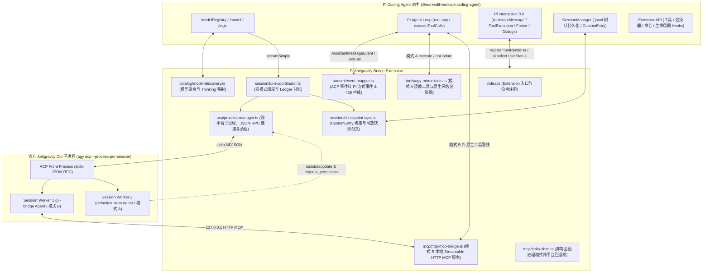
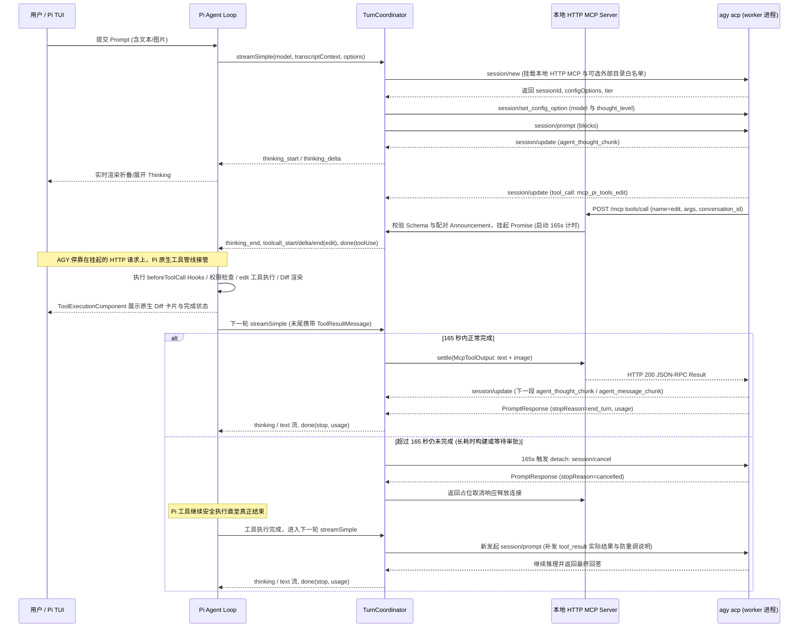
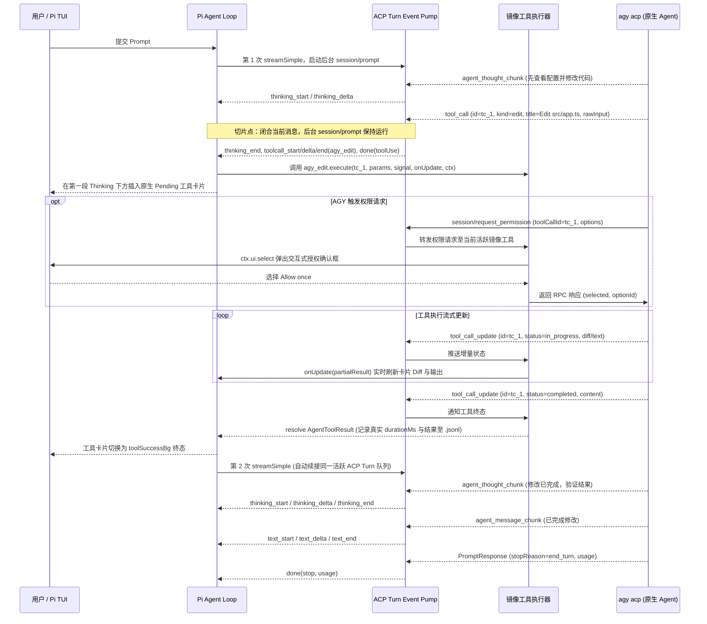
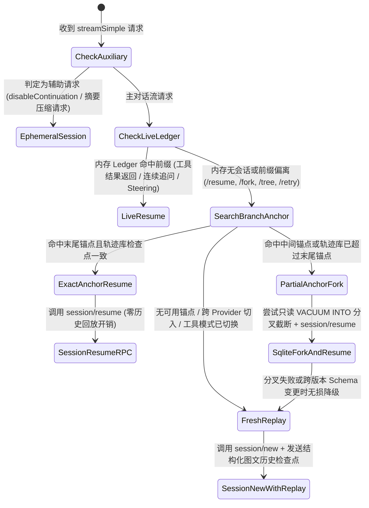

# Pi × Antigravity ACP 集成架构设计文档

## 1. 文档概述与设计目标

### 1.1 项目定位

本项目旨在构建一个标准 **Pi Package / Extension**（npm 包名：`pi-antigravity-bridge`，开源仓库：`https://github.com/onprs/Pi-Antigravity-Bridge.git`，采用 **MIT 协议**开源，同时通过 **npm 官方源**与 **GitHub 仓库**双渠道分发），基于官方 Agent Client Protocol（`agy acp`）将 Google Antigravity CLI 接入 Pi（`@earendil-works/pi-coding-agent`），使 Antigravity 成为 Pi TUI 内可直接选择、无缝切换的原生 Agent 后端。

核心体验目标：

1. **交互零切换**：完整保留 `pi` 命令、TUI 布局、主题配色、快捷键、编辑器操作、消息队列（Steer / Follow-up）及会话树管理（`/resume`、`/fork`、`/tree`、`/compact`、`/export`）。
2. **模型与思考原生化**：Antigravity 提供的 Gemini、Claude 等模型直接接入 Pi 模型选择器（`/model`），原生联动 Pi 的 Thinking 档位控制（`low`、`medium`、`high`、`xhigh`、`max`）与思考块折叠渲染。
3. **双工具体系自由切换**：支持 **Pi 工具主控模式**（复用 Pi 内置工具、Extension 工具、`codemode`、Pi MCP 与审批 Hooks）与 **AGY 原生工具主控模式**（复用 AGY 原生文件/终端工具、Subagents、Swarm 与沙箱），两种模式下工具调用均呈现为统一的 Pi 原生 `ToolExecutionComponent` 工具卡片。
4. **可配置的生态桥接**：提供独立开关精确控制是否将 Pi 侧的 **MCP**、**Skills** 与 **`AGENTS.md`（项目上下文规则）** 桥接给 AGY，同时支持按需保留 AGY 自身的原生配置，避免提示词重复注入与上下文污染。
5. **双平台原生兼容与开箱即装**：架构设计同时面向 **Windows** 与 **Ubuntu（Linux）**（兼顾 macOS）公开用户环境，消除对特定平台命令行工具（如 `nc`）的隐式依赖，支持通过 `pi install` 从 npm 或 GitHub 直接安装即用。

### 1.2 调查基线与确定性分级原则

本设计严格依据源码审计与本机协议握手实证编写，调查基线如下：

- **Pi 基线**：`@earendil-works/pi-coding-agent@1.6.0`（含 `@earendil-works/pi-ai`、`@earendil-works/pi-agent-core`、`@earendil-works/pi-tui`、`@earendil-works/pi-mcp`）实际发布包与类型定义。
- **Antigravity CLI 基线**：官方 `agy 1.5.13` 命令行实测、`agy acp` JSON-RPC 握手实测、二进制符号与协议标签核查，以及 `antigravity.google/docs` 官方文档。
- **参考项目基线**：`can1357/oh-my-pi`（`packages/ai/src/providers/antigravity-cli/*` 及 Issue `#19221`）与 `czg86389-hub/ACP-Ant`（`acp_ant.py`、`scripts/acp_probe.py`）最新主分支源码。

文档对所有技术结论实行三级确定性标注：

- **[已验证事实]**：直接由上述源码、类型签名、官方文档或本机 `agy 1.5.13` 协议握手确认的确定行为。
- **[工程推断]**：基于已验证源码与协议规范推导出的设计结论，逻辑闭环但尚未经过完整端到端运行测试。
- **[待验证事项]**：受限于静态审计或需消耗实际配额/特定账号条件才能观测的行为，在第 8 章集中列出核查范围、原因、降级预案与验证方案。

---

## 2. 核心研究结论（七大关键问题逐项解答）

### 2.1 问题一：Pi Extension API 能够实现到什么程度？

**[已验证事实]** 经核查 `pi-coding-agent/dist/core/extensions/types.d.ts`、`core/provider-composer.js`、`modes/interactive/interactive-mode.js` 与 `pi-agent-core/dist/agent-loop.js`，**无需修改 Pi 核心仓库任何一行代码，仅凭公开 Extension API 即可实现目标需求的全部核心能力**：

| 能力域 | 对应的 Pi Extension API（`1.6.0` 实证） | 可达成的深度与源码依据 |
|---|---|---|
| 自定义模型后端 | `pi.registerProvider(name, config)`、`streamSimple`、`refreshModels(ctx)` | 支持注册独立 Provider、异步拉取动态模型目录并持久化（`ctx.publish`），支持 `oauth` 对接 `/login` 与 `/logout`（`provider-composer.js:393-426`）。 |
| 原生 Thinking 档位 | `ProviderChatModelConfig.thinkingLevelMap`、`pi.setThinkingLevel()`、`thinking_level_select` 事件 | `@earendil-works/pi-ai` 原生定义 `THINKING_LEVELS = ["minimal", "low", "medium", "high", "xhigh", "max"]`（`model-schema.d.ts:2`）。将模型不支持的档位映射为 `null`，Pi 的档位循环快捷键会自动跳过不支持档位。 |
| 流式思考与正文 | `AssistantMessageEventStream`（`thinking_start/delta/end`、`text_start/delta/end`） | `AssistantMessageComponent`（`assistant-message.js:119-161`）原生支持单条消息内多段交替的 Thinking 与 Markdown 文本块、鼠标左键点击折叠/展开及流式渲染。 |
| 工具卡片统一渲染 | `pi.registerToolRenderer(resolver)` | `ToolRendererResolver` 注释与实现（`types.d.ts:543`、`interactive-mode.js:1861`）明确支持**拦截已注册及未注册工具**的 `renderCall`、`renderResult` 与 `renderShell`，并可通过 `next()` 复用内置 `read`/`edit`/`write`/`bash` 渲染器；同时覆盖实时流式、`/resume` 历史回放（`interactive-mode.js:3420`）与 `/export` HTML 导出（`agent-session.js:3659`）。 |
| 工具集读取与接管 | `pi.getAllTools()`、`pi.getActiveTools()`、`pi.setActiveTools()`、`ToolDefinition.prepareLoadout` | 可读取全部内置工具、第三方 Extension 工具与 Pi MCP 工具（`mcp__<server>__<tool>`）的参数 Schema、Guidelines 与 Annotations，并按模式动态切换对模型暴露的工具集合。 |
| 权限弹窗与表单 | `ctx.ui.select()`、`ctx.ui.confirm()`、`ctx.ui.input()`、`ctx.ui.custom()` | 支持带 `AbortSignal` 与超时倒计时的交互式审批弹窗，支持通过 `blocked` 选项上报终端 OSC 7501 等待输入状态（`types.d.ts:40-45, 147-150`）。 |
| 会话树状态持久化 | `pi.appendEntry(customType, data)`、`ctx.sessionManager.getBranch()`、全套 `session_*` 事件 | `CustomEntry` 写入 Pi 的 `.jsonl` 会话树，随 `/fork`、`/tree` 分支自动继承，且**不会**进入发往模型的 `Message[]` 上下文（`types.d.ts:1298, 1317`）。 |
| 结构化提示词与生态互通 | `SystemMessage.sections`（`project_context`、`skills`、`mcp_servers`）、`resources_discover`、`pi.getMcpServers()` | Pi 将 `AGENTS.md`、Skills 与 MCP 说明存储为独立命名的 `sections`（`system-prompt.js:68-120`），扩展可无损按开关独立保留或剥离任意一项，无需脆弱的正则文本裁剪。 |
| 包管理与双渠道分发 | `package.json` 的 `"pi"` 清单、`pi install npm:...`、`pi install https://github.com/...` | Pi 原生支持 npm 包与 GitHub Git URL 安装更新，通过 `jiti` 直接加载 TypeScript 源码，无需预编译二进制（`docs/packages.md:9-43`、`docs/extensions.md:211`）。 |

**[已验证事实] Pi 核心机制的 3 项硬约束（设计必须正面适配）**：

1. **官方 Pi 无 `providerPayload` 与 `ProviderSessionState`**：`oh-my-pi` 在 `AssistantMessage` 上扩展了私有的 `providerPayload` 字段用于保存会话指纹；官方 `@earendil-works/pi-ai` 的 `AssistantMessage`（`pi-ai/dist/types.d.ts:382-413`）仅提供 `responseId?: string`、`responseModel?: string`、`providerThinkingLevel?: string`。因此会话映射元数据应通过 `responseId` 结合 `pi.appendEntry()` 持久化到会话分支。
2. **`ToolCall` 触发强制执行契约**：`pi-agent-core/dist/agent-loop.js:161-177` 显示，只要 `AssistantMessage.content` 包含 `type: "toolCall"`（且 `stopReason` 非 `"error"`、`"aborted"`、`"length"`），Pi Agent Loop 必定调用 `executeToolCalls()` 查找并执行对应工具，随后自动进入下一轮 `streamSimple`。模式 A（AGY 原生工具）必须配合轻量镜像代理工具完成状态同步。
3. **Provider 认证非空校验**：`provider-composer.js:372-375` 要求自定义 Provider 至少配置 `apiKey` 或 `oauth` 之一，否则注册时直接抛出 `no authentication method configured`。由于 `agy acp` 在子进程内自行管理凭据，注册 Provider 时需同时提供静态哨兵 `apiKey`（使已登录本机 `agy` 的用户直接可用）与 `oauth` 适配器（使用户执行 `/login` 时可引导调用 `agy acp --login`）。

---

### 2.2 问题二：AGY ACP 还有哪些此前未注意到的能力与内部行为？

通过对本机 `agy 1.5.13` 执行 JSON-RPC 握手探测、检索二进制符号及查阅官方文档（`docs/cli/acp.md`、`docs/ide/extensions/acp.md`、`docs/subagents.md`），确认以下关键能力与约束：

1. **`--process-per-session` 开启原生 HTTP MCP 支持 [已验证事实]**
   - 默认运行 `agy acp` 时，`initialize` 响应不包含 HTTP MCP 能力，仅支持客户端传入 Stdio MCP。
   - 传入 `--process-per-session` 后，实测 `initialize` 响应新增 `"mcpCapabilities": { "http": true }`，且每个 ACP 会话由独立的隔离 worker 子进程（`agy acp --worker`）承载。官方文档明确说明：`Serve each session from an isolated worker process. Required for HTTP MCP servers that your editor configures.`
2. **`session/resume` 无回放极速恢复与完整会话管理族 [已验证事实]**
   - `initialize` 实测通告 `sessionCapabilities: { resume: {}, close: {}, load: {}, list: {}, additionalDirectories: {} }`。
   - `session/load` 会通过 `session/update` 逐条回放历史消息与历史思考流；而 `session/resume` 直接恢复后端会话上下文且**不产生历史回放流量**（`docs/ide/extensions/acp.md:162`），非常适合 Pi 本地已持有消息历史时的断线重连与跨轮恢复。
   - `session/list` 支持枚举本机已保存的 AGY 会话。
3. **双轨模型目录与动态 `thought_level` 联动 [已验证事实]**
   - 在 `agy 1.5.13` 实测中，`session/new` 同时返回两套结构：
     - `models.availableModels`：列举带思考档位后缀的展开模型（如 `gemini-4-neon-low/medium/high/xhigh`、`gemini-4-carbon-low/medium/high`、`claude-opus-5-5-low/medium/high`、`gpt-oss-120b-medium`）。
     - `configOptions`：包含 `id: "model"`（提供裸模型 ID，如 `gemini-4-neon`、`claude-opus-5-5`，以及固定档位模型如 `gpt-oss-120b-medium`）、`id: "thought_level"`（提供当前模型支持的档位，如 `low`、`medium`、`high`、`xhigh`）和 `id: "mode"`。
   - 调用 `session/set_config_option` 切换 `model` 后，响应中返回的最新 `configOptions` 会动态更新该模型实际支持的 `thought_level` 选项集合（例如从 Neon 切换到 Carbon 时，`xhigh` 从选项中消失；部分模型支持 `max`）。同时，部分登录渠道下 `configOptions` 仅返回后缀形式模型 ID（`omp-host.ts:930-935`）。
4. **原生执行模式（`mode`）控制 [已验证事实]**
   - `session/new` 暴露 `default`（按权限规则询问）、`accept-edits`（自动批准工作区内文件修改）、`plan`（先规划后执行）三种模式，可通过 `session/set_config_option({ configId: "mode", value })` 实时切换。
5. **账号订阅等级（Tier）透出 [已验证事实]**
   - `initialize` 通告 `_meta.antigravity.tier: true`；`session/new` 响应在 `_meta.antigravity.tier` 中直接返回当前账号订阅层级信息（实测返回结构：`{ name: "Google AI Ultra", id: "g1-ultra-lite-tier", upgradeUri: "..." }`），可用于 Pi 状态栏或诊断面板展示。
6. **严禁触碰或注入系统提示词（官方风控红线）[已验证事实]**
   - 经真机实测与 `acp-worker` 日志（`policy_guardian`）确认，通过 `_meta.antigravity.systemPrompt.append` 注入外部宿主系统提示词或开启 `excludeDefaultComponents: true` 剥离默认组件会触发官方风控限制，存在账号安全风险。因此架构设计**严禁发送任何 `systemPrompt` 注入参数**，保持 Antigravity 官方原厂系统提示词完整不变。
7. **自定义 Agent YAML 挂载与原生 Plugin / Discovery Manifest 机制 [已验证事实]**
   - `agy acp --agent <name>` 会从 `<geminiDir>/config/agents/<name>/agent.md` 加载纯 YAML Frontmatter 配置（Markdown 正文保持为空以不覆盖系统提示词）：
     - `inheritCustomizations: false`：控制是否继承全局与工作区的 Skills、Rules、Plugins、Subagents 和 MCP Servers。
     - `inheritMcp: false`：单独控制是否继承 MCP 配置。
     - `tools: []`：在 `pi-tools` 模式下清空内置工具集，交由标准 ACP `mcpServers` 暴露工具。
     - `plugins: ["/abs/path/to/plugin"]`：通过符合 `agy plugin validate --strict` 规范的官方原生 Plugin 包（内含 `plugin.json`、`skills.json` 发现清单与 `rules/AGENTS.md`）按开关原生挂载 Pi 侧的 Skills 与 `AGENTS.md` 规则文件。
8. **运行中实时转向（Steering）[已验证事实]**
   - 当一个 `session/prompt` 正在流式执行时，向同一 `sessionId` 发送新的 `session/prompt` 会直接触发 AGY 原生 Steering，引导当前正在执行的轮次而无需先手动取消并重建会话（`docs/ide/extensions/acp.md:136`）。
9. **交互式提问（`elicitation/create`）、自动标题（`session_info_update`）与实时上下文水位（`usage_update`）[已验证事实]**
   - 当 AGY 需要向用户发起结构化提问时，会向支持 Elicitation 的 ACP 客户端发送 `elicitation/create` 请求；若被客户端拒绝则返回聊天文本提问（二进制日志字符串验证）。
   - `session/update` 除 `agent_thought_chunk`、`agent_message_chunk`、`tool_call`、`tool_call_update` 外，还会推送 `usage_update`（当前已占用上下文 Token 数 `used`）、`available_commands_update`（可用斜杠命令与技能）及会话标题变更。
10. **多模态输入、嵌入资源（`embeddedContext`）与 MCP 调用链路追踪元数据 [已验证事实]**
    - Prompt 支持 `text`、`image`（base64 + mimeType）及 `resource` / `resource_link`（`file://` URI）。
    - AGY 调用外部 MCP 工具时，会在 `tools/call` 请求的 `params._meta` 中注入 `"antigravity.google/conversation_id"` 与 `"antigravity.google/root_conversation_id"`，即使调用源自嵌套 Subagent 也能精准定位顶层会话（二进制内嵌更新日志验证）。
11. **四项关键内部边界约束 [已验证事实]**
    - **客户端 `fs`/`terminal` 能力无效**：二进制中不存在 `fs/read_text_file`、`fs/write_text_file` 或 `terminal/*` 客户端调用，AGY 原生工具始终在 AGY 自身进程内执行。
    - **MCP 工具调用 180 秒硬超时**：AGY 对单次 MCP `tools/call` 设有 180 秒超时上限，且 MCP progress 通知不会延长该计时器（`omp-mcp-bridge.ts:3-4`）。
    - **按模型差异化的内置压缩阈值（Checkpointer）**：对本机 `agy 1.5.13` 二进制内嵌 `model_profiles` 全表核查显示，AGY 按模型分别设定了不同的自动压缩阈值（`gpt-oss-120b-medium` 为 80K，Gemini 2.5 系列为 128K，部分旧 Profile 为 256K，Gemini 4 Neon 等新主力 Profile 已提升至 **512K**，Claude 1M 实验变体达 **840K**，且服务端可通过实验配置动态调整）。运行中 AGY 通过 `usage_update: { used, size }` 实时上报当前会话窗口容量，后端触发压缩时在会话内部自动替换为结构化摘要且不会通过 ACP 单独发送压缩事件。
    - **配额重试文本内联输出**：遇到 429 `RESOURCE_EXHAUSTED` 时，AGY 自行循环重试并将 `⚠ API error (attempt N): RESOURCE_EXHAUSTED ...` 作为普通 `agent_message_chunk` 文本流式输出（`omp-host.ts:50-55, 777-787`）。

---

### 2.3 问题三：是否有比 MCP 更好的外部工具接入机制？

针对“将 Pi 工具暴露给 AGY 调用（模式 B）”这一需求，全部 4 种候选技术路线的实证对比如下：

| 候选机制 | 工作原理 | 跨平台性（Win + Ubuntu） | 可靠性与类型安全 | 动态工具热更新 | 结论 |
|---|---|---|---|---|---|
| **1. ACP 客户端能力 (`fs/*`, `terminal/*`)** | 声明 `clientCapabilities`，期盼 AGY 将文件/终端操作回调给客户端 | 跨平台 | **不可行**：`agy 1.5.13` 未实现客户端回调，且无法表达任意自定义 Pi 工具 | 不支持 | **排除（协议未实现）** |
| **2. 提示词模拟 Function Calling (`ACP-Ant` 路线)** | 在提示词中拼接工具说明，用正则/XML 解析正文中的 `<tool_calls>` 并在检测到闭合标签时 `cancel` | 跨平台 | **低**：易受代码块文本干扰、无原生约束采样、模型易抢答幻觉 `<tool_result>`、工具无法返回图片 | 支持 | **排除（可靠性不足）** |
| **3. `--ide-mcp-port` 裸 TCP NDJSON 桥 (`Oh My Pi` 路线)** | 宿主监听本地 TCP 端口，`agy` 内部调用系统 `nc` 连接并挂载为 `ide-tools` | **差**：`agy acp --help` 明确声明 `requires 'nc' in $PATH`，Windows 默认无 `nc` | **高**：走原生 Function Calling 协议栈，支持文本与图片结果 | **差**：进程级静态工具表，增减工具需重启 `agy` 进程 | **仅作可选后备通道** |
| **4. `--process-per-session` + `mcpServers` 本地 Streamable HTTP MCP 桥（辅以 Stdio Shim 回退）** | 宿主用 `node:http` 启动本地 `127.0.0.1:0/mcp` 端点，通过 ACP 标准参数 `mcpServers` 按会话注入 | **优**：纯 Node.js 标准库实现，Windows 与 Ubuntu 零外部依赖 | **高**：官方公开文档支持的标准 ACP 路径，原生结构化参数与多模态结果，自带 `conversation_id` 元数据 | **优**：会话级独立工具表，支持 `notifications/tools/list_changed` | **首选核心路线** |

**结论**：在当前官方 `agy` 架构下，不存在绕过 MCP 直接向 `agy` 注入外部函数声明的私有 JSON-RPC 接口；而在所有合法接入方式中，**`--process-per-session` 配合本地回环 Streamable HTTP MCP Server** 全面优于 `--ide-mcp-port`——它同时解决了 Windows 无 `nc` 依赖问题、多会话工具集隔离问题以及激活工具变更时免重启宿主连接的问题。当用户显式禁用 `--process-per-session` 时，可通过极简 Node.js Stdio MCP 转发脚本（`node mcp-stdio-shim.mjs --port <port>`）回连同一本地服务，同样保持 100% Windows + Ubuntu 兼容。

---

### 2.4 问题四：Oh My Pi 现有实现有哪些值得借鉴与必须改造的部分？

#### 值得直接借鉴的 7 项核心机制

1. **Park-and-Yield 跨步挂起模型**（`omp-host.ts:682-699`）：在收到 MCP `tools/call` 时创建 `Promise.withResolvers()` 挂起 MCP 响应，立即将调用封装为 `ToolCall` 推送给 `StepWriter` 并以 `stopReason: "toolUse"` 结束当前推理步；待 Pi Agent Loop 执行完工具再次调用 `streamSimple` 时，用 `ToolResultMessage` 结算挂起的 Promise，使双循环在单线程异步时序上严丝合缝。
2. **165 秒预取消剥离与迟到结果补发（Detach & Late Tool Result）**（`omp-host.ts:47, 598-612, 313-316`）：针对 AGY 180 秒 MCP 超时限制，设定 165 秒守护定时器。超时临近但 Pi 工具仍在执行（例如长耗时测试或人工审批等待）时，先对 AGY 执行 `session/cancel` 并等待确认排空，再向旧 MCP 连接返回取消占位符；待 Pi 工具真正执行完毕后，在下一轮通过 `session/prompt` 补发结构化 `<tool_result>` 文本与图片块，并明确提示模型“工具已完成，禁止重复调用”。
3. **ACP 公告门控校验（Announcement Waiter）**（`omp-host.ts:661, 701-719, 740-747`）：要求 MCP `tools/call` 必须与当前活跃会话 `session/update` 推送的 `tool_call` 通知配对（2 秒窗口），拦截已取消轮次残留的迟到调用或跨会话串扰。
4. **MCP 层参数 JSON Schema 预校验与自愈反馈**（`omp-host.ts:679-681, 992-1028`）：在唤醒 Pi Agent Loop 前先校验工具参数。若模型生成的参数不符合 Schema，直接在 MCP 层向 AGY 返回包含具体错误字段路径与期望 Schema 的 `isError: true` 结果，使模型在**同一 ACP Turn 内自动修正重试**，避免在 Pi TUI 中产生无效报错卡片。
5. **流式行尾缓冲与 429 配额耗尽提取**（`omp-host.ts:755-787`）：对未换行的末尾文本进行前缀匹配缓冲，一旦识别出 `API error (attempt N): ... RESOURCE_EXHAUSTED (code 429)`，立即取消 AGY 内部死循环重试并向外抛出标准 429 错误，避免错误日志污染聊天记录。
6. **双形态模型 ID 解析器**（`omp-host.ts:936-942`）：优先匹配裸模型 ID + `thought_level` 配置项；若服务端仅通告后缀 ID，自动回退匹配 `${modelId}-${effort}`。
7. **基于 SHA-256 内容摘要（`transcriptDigest`）的三态会话规划**（`omp-reconcile.ts:39-83`）：忽略时间戳与统计元数据，仅对模型可见的有序内容计算摘要，精确判定 `resume`、`restore` 或 `fresh` 重放（且重放时完整保留历史图片二进制块）。

#### 针对官方 Pi 必须重构或摒弃的 5 项设计

1. **移除 `nc` 与 Bun 运行时专属 API**：将 `Bun.spawn`、`Bun.listen`、`bun:sqlite` 全部替换为 Node.js 原生跨平台实现（`node:child_process`、`node:http`、`node:sqlite`），支持 Windows 与 Ubuntu。
2. **严守零凭据导出原则**：`oh-my-pi` 将 AGY 的 OAuth 授权提取至自有凭据库并生成独立凭据文件（Issue `#19221` 已指出其与标准 ACP 编辑器行为存在差异）。本扩展**绝不读取、解密、复制或存储 AGY 的 OAuth 令牌**，完全复用本机官方 `agy` 自身的认证状态。
3. **移除硬编码 `--dangerously-skip-permissions`**：模式 B 下自定义 Agent 已设 `tools: []`，无需跳过权限标志；模式 A 下默认走 ACP `session/request_permission` 映射至 Pi TUI 确认框，尊重用户安全边界。
4. **重构会话状态存储层**：利用 Pi 的 `pi.appendEntry()` 与 `sessionManager.getBranch()` 替代 `oh-my-pi` 私有的 `AssistantMessage.providerPayload`。
5. **补齐模式 A（AGY 原生工具）与双生态融合能力**：`oh-my-pi` 彻底剥离了 AGY 的工具、Skills、MCP 与 Subagents；本设计将其扩展为可切换的双模架构。

---

### 2.5 问题五：如何让 AGY 原生工具和 Pi 工具都自然呈现在 Pi 的原生 UI 中？

- **模式 B（Pi 工具模式）**：桥接层将 MCP 调用还原为 Pi 原始工具名（如 `read`、`edit`、`write`、`bash`、`grep`、第三方扩展工具名或 `mcp__<server>__<tool>`）并发出标准 `ToolCall`。Pi Agent Loop 原生驱动 `ToolExecutionComponent`，100% 走 Pi 原有的工具渲染器、Diff 预览、流式输出与折叠逻辑。
- **模式 A（AGY 原生工具模式）**：创新采用 **“单 Turn 流分片 + 镜像工具同步管线（Turn-Sliced Mirror Pipeline）”** 结合 `pi.registerToolRenderer()`：
  1. 当 AGY 在 `session/update` 中推送原生 `tool_call` 时，当前 `streamSimple` 立即闭合前序 `thinking` / `text` 块，发射一个映射后的语义镜像 `ToolCall`（如 `agy:read`、`agy:edit`、`agy:write`、`agy:bash`、`agy:search`、`agy:subagent`、`agy:mcp`）并以 `stopReason: "toolUse"` 结束当前消息步；**底层 ACP `session/prompt` 保持运行**，后续事件进入内存事件队列。
  2. Pi Agent Loop 紧接着在该段 Thinking 正下方创建真实的 `ToolExecutionComponent` 卡片，并调用对应镜像工具的 `execute(..., onUpdate, ctx)`。
  3. 镜像工具在 `execute()` 内部消费同一 `toolCallId` 的 `session/request_permission`（调用 `ctx.ui.select` 弹窗审批）与 `tool_call_update`（通过 `onUpdate` 实时刷新流式输出与进度），待收到 `completed` / `failed` 终态后返回 `AgentToolResult`。
  4. 通过 `pi.registerToolRenderer()` 为 `agy:*` 工具提供与 Pi 内置工具同构的视觉样式（直接复用 Pi `theme` 的 `toolPendingBg`、`toolSuccessBg`、`toolErrorBg`、`toolTitle`、`toolOutput` 色板、Diff 高亮格式及 `keyHint("app.tools.expand", "to expand")` 折叠交互）。
  5. Pi Agent Loop 完成工具记录后自动发起下一轮 `streamSimple`，无缝接续后台同一个 ACP Turn 后续产生的下一段 `agent_thought_chunk` 或正文回答。

由此，无论处于模式 A 还是模式 B，聊天流中均呈现完全一致的 **“折叠/展开 Thinking 块 → 原生配色工具卡片（含实时状态、流式输出、耗时、点击展开）→ 下一段 Thinking 块 → Markdown 正文”** 体验，且历史记录持久保存在 Pi `.jsonl` 中，`/resume` 与 `/export` 均原样复现。

---

### 2.6 问题六：如何处理双 Agent Loop、工具调用与会话状态之间的关系？

核心原则是 **“单时刻单主控解耦，以摘要账本（Ledger）对齐状态”**：

1. **控制权正交化**：
   - 在 **模式 B** 中，Pi Agent Loop 拥有工具调度、并发控制、审批 Hooks 与重试的绝对主权；AGY 的内部 Loop 在 MCP `tools/call` 处被阻塞挂起，退化为带服务端 KV/上下文记忆的有状态推理步进器。
   - 在 **模式 A** 中，AGY Agent Loop 拥有工具执行、重试与 Subagent 编排主权；Pi Agent Loop 通过镜像工具在每个工具边界与 AGY 事件流做同步步进（Lockstep），充当 UI 状态机与历史持久化器。
2. **并发工具调用对齐**：
   - 若单步内产生并行工具调用，模式 B 通过短窗口收集同帧已宣告的多个 MCP `tools/call`，封装进同一条 `AssistantMessage` 交由 Pi 的 `executeToolCallsParallel` 并发执行，待全部产生 `ToolResultMessage` 后在下一 `streamSimple` 入口一次性结算全部挂起的 MCP 请求。
   - 模式 A 下若 AGY 并发推送多个 `tool_call`，同样支持按微窗口批量发射或按到达顺序逐个切片同步。
3. **会话偏离自动自愈**：每次进入 `streamSimple` 时，对比传入 `TranscriptContext` 的消息序列摘要与当前内存 `Ledger`：
   - **完全连续（`resume`）**：仅发送新增的用户消息、Steering 消息或结算挂起的工具结果。
   - **发生历史回退/分支/编辑/模式切换（`restore` / `fresh`）**：立即安全中止并排空任何挂起中的旧 ACP Turn，尝试恢复目标节点绑定的后端会话检查点；若检查点不可用或跨模式工具集已变更，则关闭旧会话并通过 `session/new` 发送结构化历史检查点重放（`replayPrompt`），确保两侧上下文严格一致。

---

### 2.7 问题七：怎样充分保留 Pi 和 AGY 各自的优势？

通过 **工具主控模式 × 独立生态桥接开关** 的正交组合，用户可按需选择纯净单侧生态或混合增强生态：

| 生态能力 | 核心控制开关 | `pi-tools`（模式 B）行为 | `agy-tools`（模式 A）/ `hybrid` 行为 |
|---|---|---|---|
| **基础与扩展工具** | `toolMode` | 使用 Pi 内置工具与第三方 Pi Extensions 工具 | `agy-tools` 使用 AGY 原生文件/终端/搜索工具；`hybrid` 额外通过 HTTP MCP 挂载 Pi 专属扩展工具 |
| **Pi MCP 桥接** | `bridgePiMcp`（可选 `true`/`false`） | 开启时向 AGY 暴露 Pi 的 MCP 工具、`codemode`/`tool_search` 与 `mcp_servers` 提示词；关闭时彻底剔除 Pi MCP 工具与提示词段落 | 关闭时仅使用 AGY 自身 `mcp_config.json`；开启时可将 Pi 的 MCP 通过宿主 HTTP 桥（共享 Pi OAuth 态）或直接配置注入 AGY |
| **Pi Skills 桥接** | `bridgePiSkills`（可选 `true`/`false`） | 开启时保留 `sections.skills` 传给 AGY；关闭时剥离 Pi Skills 列表以节省上下文 | 关闭时仅使用 AGY 原生 Skills；开启时将去重后的 Pi 特有 Skills 追加给 AGY 并授权其目录可读 |
| **Pi `AGENTS.md` 桥接** | `bridgePiAgentsMd`（可选 `true`/`false`） | 开启时保留 `sections.project_context`（含 `AGENTS.md`）传给 AGY；关闭时剥离该段落 | 关闭时完全交由 AGY 原生规则引擎处理 `GEMINI.md`/`AGENTS.md`；开启时按文件路径去重后补充注入 AGY 未覆盖的上下文文件 |
| **AGY 原生能力保留** | `agyInheritCustomizations` / `shareAgySkillsToPi` | 默认关闭 AGY 自定义继承以防双端重复加载；可选将 AGY 通用 Skills 反向注册进 Pi `/skill:` | 默认开启 AGY 原生 Skills、Rules、`invoke_subagent`（`research`/`browser`/`self`）与 `/swarm` 能力 |
| **上下文压缩** | Pi 原生 `compaction` 配置 + `/compact` | 按各模型真实有效窗口（`usage_update.size` 或模型目录值减去 `reserveTokens`）触发自动压缩，或由用户随时手动执行 `/compact`；压缩完成后自动轮换新 ACP 会话 | 默认由 AGY Checkpointer 按模型窗口自动管理，同时完整支持在任意时刻手动执行 Pi `/compact` 触发摘要与会话轮换 |

---

## 3. 系统总体架构设计

### 3.1 模块分层与目录结构



建议工程源码目录组织：

```text
Pi-Antigravity-Bridge/
├── LICENSE                       # MIT 开源许可证
├── README.md                     # 面向 GitHub 与 npm 用户的公开使用文档
├── CHANGELOG.md                  # 版本变更日志（供 Pi 启动更新提示读取）
├── package.json                  # Pi Package 清单（声明 pi.extensions 与 peerDependencies）
├── tsconfig.json                 # TypeScript 严格类型检查配置
├── docs/
│   └── DESIGN.md                 # 架构设计文档
├── assets/
│   └── agents/
│       └── pi-bridge.md          # 模式 B 极简自定义 Agent 模板
└── src/
    ├── index.ts                  # Extension 工厂入口
    ├── config.ts                 # 跨平台路径解析、桥接开关与环境变量读取
    ├── acp/
    │   ├── protocol.ts           # ACP JSON-RPC 类型定义与轻量帧解析器
    │   ├── binary-resolver.ts    # Windows / Ubuntu / macOS agy 可执行文件定位
    │   └── process-manager.ts    # 子进程池、优雅关闭与 Windows 进程树清理
    ├── catalog/
    │   └── model-discovery.ts    # 动态模型探测、后缀聚合与 thinkingLevelMap 生成
    ├── mcp/
    │   ├── http-mcp-bridge.ts    # Node.js Streamable HTTP MCP 服务端与挂起池
    │   ├── pi-mcp-forwarder.ts   # Pi MCP 可选过滤与跨端桥接器（via-host / direct-config）
    │   ├── stdio-shim.ts         # 纯 Node.js Stdio-to-HTTP 转发脚本（可选回退）
    │   └── schema-validator.ts   # 工具参数预校验与自愈错误格式化
    ├── session/
    │   ├── turn-coordinator.ts      # 核心会话状态机、双模式分发与辅助请求旁路
    │   ├── customization-mounter.ts # 基于官方原生 Plugin / skills.json / rules 挂载 AGENTS.md 与 Skills
    │   ├── reconcile.ts             # SHA-256 摘要计算、resume/restore/fresh 规划与重放构建
    │   └── checkpoint-sync.ts       # Pi CustomEntry 读写与可选 SQLite 只读快照分叉
    ├── stream/
    │   └── event-mapper.ts       # Step 流写出器、429 软错误行尾缓冲、Usage 归一化
    ├── tools/
    │   ├── agy-mirror-tools.ts   # 模式 A 镜像工具定义、权限与 Elicitation 交互桥
    │   └── agy-renderers.ts      # 模式 A 工具卡片与 Diff 原生主题渲染器
    └── ui/
        ├── commands.ts           # /agy 命令族实现（模式切换、桥接开关、状态、会话）
        └── status-bar.ts         # 状态栏模式徽标、Tier 与压缩告警提示
```

### 3.2 跨平台（Windows + Ubuntu）关键适配设计

针对仓库在 Windows 与 Ubuntu 双环境开发运行的要求，底层基础设施统一采用纯 Node.js 标准库实现，重点处理以下平台差异：

1. **`agy` 可执行文件定位（`binary-resolver.ts`）**：
   - 优先级 1：用户在配置或环境变量 `PI_AGY_BIN` 中显式指定的路径。
   - 优先级 2：系统 `PATH` 查找（Ubuntu 查找 `agy`；Windows 按 `PATHEXT` 查找 `agy.exe`、`agy.cmd`）。
   - 优先级 3：公开环境的平台标准安装位置探测：
     - **Ubuntu / Linux**：`~/.local/bin/agy`、`/usr/local/bin/agy`、`~/.gemini/antigravity-cli/bin/agy`。
     - **Windows**：`%LOCALAPPDATA%\Programs\Antigravity\bin\agy.exe`、`%LOCALAPPDATA%\antigravity-cli\bin\agy.exe`、`%USERPROFILE%\.local\bin\agy.exe`。
   - 启动时对 `.exe` 或 ELF 二进制直接调用 `child_process.spawn(bin, args, { shell: false, windowsHide: true })`，避免 Windows `cmd.exe` 参数转义漏洞与弹窗闪烁。
2. **配置与数据目录解析（`config.ts`）**：
   - 使用 `os.homedir()` 与 `path.join()` 统一解析 `~/.gemini`（Windows 下对应 `%USERPROFILE%\.gemini`）与 `~/.pi/agent`，支持 `--gemini-dir` 覆盖，严禁硬编码 `/` 分隔符或 POSIX 专属环境变量。
3. **无 `nc` 的本地 MCP 传输（`http-mcp-bridge.ts`）**：
   - 默认启用 `agy acp --process-per-session`，通过 `node:http` 绑定 `127.0.0.1` 随机空闲端口（`port: 0`），生成随机一次性会话令牌放入请求头 `Authorization: Bearer <token>`，在 `session/new` 的 `mcpServers` 中传入 `{ name: "pi_tools", type: "http", url: "http://127.0.0.1:<port>/mcp", headers: [{ name: "Authorization", value: "Bearer <token>" }] }`，同时为子进程注入 `NO_PROXY=127.0.0.1,localhost`，防止用户全局代理劫持本地回环流量（借鉴 `acp-ant.py:493` 验证经验）。
4. **子进程生命周期与孤儿 Worker 清理（`process-manager.ts`）**：
   - `--process-per-session` 模式下，`agy acp` 主进程会派生子 `--worker` 进程。
   - 正常关闭顺序：发送 `session/close` RPC → 关闭子进程 `stdin` 等待自然退出（1.5 秒超时）。
   - 强制清理顺序：
     - **Ubuntu**：创建子进程时设置进程组或向 `pid` 发送 `SIGTERM`，超时后发送 `SIGKILL`。
     - **Windows**：Windows 无优雅 `SIGTERM`，超时后执行 `taskkill /PID <pid> /T /F`（`windowsHide: true`）递归清理主进程及其全部 `--worker` 子进程树，防止残留后台进程占用会话数据库文件锁。

### 3.3 认证、安全边界与合规说明

1. **零凭据触碰原则**：
   - 本扩展不读取、不解析、不复制、不持久化 `agy` 内部的任何 OAuth 令牌或密钥环数据。
   - 注册 Provider 时，同时配置：
     - `apiKey: "agy-managed"`（满足 Pi `ModelRegistry` 可用性检查，使已登录 `agy` 的用户开箱即见模型列表）；
     - `oauth` 登录处理器：当用户在 Pi 中执行 `/login antigravity` 时，扩展向用户说明认证由官方 `agy` 自行管理，并在交互终端中引导执行官方 `agy acp --login`（支持无浏览器/SSH 终端授权码登录）或检测 `GEMINI_API_KEY` / ADC 环境配置，完成后触发 `refreshModels` 刷新模型列表。
2. **客户端身份诚实性原则**：
   - **[已验证事实]** 官方文档 `docs/ide/extensions/acp.md:152` 声明，Gemini 模型向所有 ACP 客户端开放，第三方模型（如 Claude）仅向特定编辑器开放；而在本机 `agy 1.5.13` 握手实测中，使用自定义真实客户端名 `clientInfo: { name: "pi-probe", version: "0.1.0" }` 时，`session/new` 依然返回了 `claude-opus-5-5`、`claude-sonnet-5-5` 与 `gpt-oss-120b-medium`。
   - **设计准则**：初始化握手固定上报真实身份 `clientInfo: { name: "pi-antigravity-bridge", version: "<pkg.version>" }`，**严禁伪造其他 IDE 的 `clientInfo` 绕过服务端策略**。模型目录完全以服务端实时返回的可用列表为准动态生成，若特定账号或未来版本下服务端过滤了第三方模型，模型选择器自动如实反映。
3. **合规风险透明提示**：
   - 参考 `oh-my-pi` Issue `#19221` 的讨论，在文档与首次 `/login antigravity` 提示中向用户客观说明：本扩展通过 Google 公开文档化的 `agy acp` 标准协议接入，在模式 B 下会将 Pi 的系统提示词与工具 Schema 通过 ACP 与 MCP 传给 `agy`；Google 对第三方编码 Agent Harness 驱动 `agy acp` 的服务条款解释存在不确定性，由用户知情选择模式 A（完整原生 `agy` Agent）或模式 B（Pi 工具桥接）。

### 3.4 开源协议与双渠道分发架构（npm & GitHub）

本项目采用 **MIT 协议**开源，遵循 Pi 官方 Package 规范（`pi-coding-agent/docs/packages.md`）同时发布至 **npm** 与 **GitHub**（`https://github.com/onprs/Pi-Antigravity-Bridge.git`）。

#### 3.4.1 `package.json` 清单与依赖边界设计

**[已验证事实]** 根据 `docs/packages.md:104-115` 与 `docs/extensions.md:211`：

1. Pi 使用内置 `jiti` 加载器直接执行 TypeScript 扩展入口（`./src/index.ts`），从 GitHub 仓库或 npm 安装后均**无需任何本地预构建步骤**，保证公开用户一键安装即用。
2. 宿主提供的 `@earendil-works/pi-*` 与 `typebox` 包必须声明在 `peerDependencies`（版本设为 `"*"`），不得放入 `dependencies`，以确保与宿主共享同一套运行时类与注册表。
3. 扩展内部全部采用 Node.js 标准库实现（`dependencies` 为空），在 Windows 与 Ubuntu 下均无原生模块编译开销。
4. 包含 `"pi-package"` 关键词以接入 Pi 官方扩展目录检索，并在根目录维护标准格式 `CHANGELOG.md` 供 Pi 升级后自动展示更新摘要。

```json
{
  "name": "pi-antigravity-bridge",
  "version": "0.1.0",
  "description": "Google Antigravity CLI (agy acp) agent backend bridge for Pi",
  "license": "MIT",
  "type": "module",
  "repository": {
    "type": "git",
    "url": "git+https://github.com/onprs/Pi-Antigravity-Bridge.git"
  },
  "homepage": "https://github.com/onprs/Pi-Antigravity-Bridge#readme",
  "bugs": {
    "url": "https://github.com/onprs/Pi-Antigravity-Bridge/issues"
  },
  "keywords": [
    "pi-package",
    "antigravity",
    "acp",
    "coding-agent"
  ],
  "pi": {
    "extensions": [
      "./src/index.ts"
    ]
  },
  "files": [
    "src",
    "assets",
    "CHANGELOG.md",
    "LICENSE",
    "README.md"
  ],
  "peerDependencies": {
    "@earendil-works/pi-agent-core": "*",
    "@earendil-works/pi-ai": "*",
    "@earendil-works/pi-coding-agent": "*",
    "@earendil-works/pi-tui": "*",
    "typebox": "*"
  }
}
```

#### 3.4.2 公开用户环境与开发维护环境的使用方式分离

- **公开用户环境（面向最终用户，前置要求仅为系统已安装 `pi` 与 `agy`）**：
  - 通过 npm 安装稳定版（写入用户全局 `~/.pi/agent/settings.json`）：
    ```bash
    pi install npm:pi-antigravity-bridge
    ```
  - 通过 GitHub 仓库安装最新主分支或锁定版本标签：
    ```bash
    pi install https://github.com/onprs/Pi-Antigravity-Bridge.git
    pi install git:github.com/onprs/Pi-Antigravity-Bridge@v0.1.0
    ```
  - 单次会话免安装试用：
    ```bash
    pi -e npm:pi-antigravity-bridge
    ```
  - 升级与卸载：
    ```bash
    pi update --extensions
    pi remove npm:pi-antigravity-bridge
    ```
- **开发维护环境（仅面向项目贡献者本地调试，不写入公开 README 默认安装步骤）**：
  - 在本地工作区克隆仓库后，执行 `pi -e ./src/index.ts` 启动调试，修改代码后在 Pi TUI 内执行 `/reload` 即时热重载，发布前运行 `npx tsc --noEmit` 与测试套件验证。

---

## 4. 模型发现、Thinking 档位与流式事件映射

### 4.1 双轨模型聚合与动态发现（`model-discovery.ts`）

启动与刷新流程：

1. **静态种子 + 缓存快照启动**：首次加载同步读取上次成功探测缓存的模型列表（缓存在 `~/.pi/agent/cache/antigravity-models.json`）；若无缓存，提供保守的基础种子模型定义以保证离线启动不阻塞。
2. **`refreshModels` 在线探测（零配额消耗）**：
   - 利用 `ProviderConfig.refreshModels(context)` 接口，在 Pi 后台启动、打开 `/model` 选择器或完成 `/login` 后执行。
   - 复用空闲 `agy acp` 进程发起一次 `session/new({ cwd, mcpServers: [] })`，读取 `models.availableModels`、`configOptions` 与 `_meta.antigravity.tier`，随即调用 `session/close` 并清理该空会话文件（与 `acp-ant.py:595-616` 验证一致，不发送 `session/prompt`，零 Token/配额消耗）。
3. **模型家族聚合算法**：
   - 从 `models.availableModels`（如 `gemini-4-neon-low/medium/high/xhigh`）与 `configOptions[id="model"]`（如 `gemini-4-neon`）交叉提取**基础模型 ID** 及其实际支持的 **Thinking 档位集合**：
     - 若某基础模型（如 `gemini-4-neon`）在 `availableModels` 中存在多个 `-{low|medium|high|xhigh|max}` 变体，则在 Pi 中仅注册 **1 个清爽的基础模型条目** `antigravity/gemini-4-neon`（显示名 `Gemini 4 Neon`），不把每个档位拆成重复的模型行。
     - 若某模型无多档位变体（如 `gemini-pro-orchestrator`、`gpt-oss-120b-medium`），保留其原始 ID。
   - 若 `availableModels` 未提供后缀展开（部分账号仅返回裸 ID），则按需对该会话调用 `session/set_config_option({ configId: "model", value: id })` 读取返回的 `thought_level.options` 并缓存。

### 4.2 Thinking 档位精确映射（`thinkingLevelMap`）

利用 `@earendil-works/pi-ai` 原生的 `ThinkingLevelMap` 机制，为每个聚合后的模型生成精确的档位映射表：

```ts
// 以实测 gemini-4-neon（支持 low/medium/high/xhigh）与 gemini-4-carbon（支持 low/medium/high）为例：
const neonThinkingLevelMap: ThinkingLevelMap = {
  minimal: null,   // 标记不支持，Pi 切换档位时自动跳过
  low: "low",
  medium: "medium",
  high: "high",
  xhigh: "xhigh",
  max: null,       // 若服务端为某模型通告了 max，则设为 "max"
};

const carbonThinkingLevelMap: ThinkingLevelMap = {
  minimal: null,
  low: "low",
  medium: "medium",
  high: "high",
  xhigh: null,     // Carbon 无 xhigh，自动在 Pi UI 中屏蔽该档位
  max: null,
};
```

请求执行时的档位下发逻辑（兼容双轨服务端）：

1. 读取 Pi 传入的 `options?.reasoning`（即用户在 Pi 中选定的 `ThinkingLevel`；若用户设为 `"off"`，`options.reasoning` 为 `undefined`，回退至该模型最低可用档位 `"low"` 或服务端默认档位，并在状态栏标明实际生效档位 `providerThinkingLevel`）。
2. 检查当前会话 `configOptions[id="model"]` 通告的候选值：
   - 若包含裸 ID（如 `gemini-4-neon`）：先通过 `session/set_config_option` 设定 `model = "gemini-4-neon"`，再设定 `thought_level = desiredEffort`。
   - 若仅包含后缀 ID（如 `gemini-4-neon-xhigh`）：直接设定 `model = "${baseId}-${desiredEffort}"`。
3. 将实际下发的档位写入 `AssistantMessage.providerThinkingLevel`，确保会话记录可追溯。

### 4.3 ACP 流式事件到 Pi 消息流的状态机映射

单个推理步（`StepStreamMapper`）维护当前打开的内容块索引（同一时刻最多打开一个 `thinking` 块或一个 `text` 块），映射规则如下：

| ACP 来源事件 / 响应 | 条件与处理逻辑 | 发射的 Pi `AssistantMessageEvent` |
|---|---|---|
| Step 初始化 | 创建空 `AssistantMessage` | `start` |
| `session/update`: `agent_thought_chunk` | `content.type === "text"` 且非空；若当前有打开的 `text` 块先发射 `text_end`；通过行尾缓冲器检查无软错误后追加 | 首次发射 `thinking_start`，后续发射 `thinking_delta` |
| `session/update`: `agent_message_chunk` | `content.type === "text"` 且非空；若当前有打开的 `thinking` 块先发射 `thinking_end`；通过行尾缓冲器过滤 `API error (attempt N): RESOURCE_EXHAUSTED` | 首次发射 `text_start`，后续发射 `text_delta` |
| 模式 B 收到配对 MCP `tools/call` / 模式 A 收到 ACP `tool_call` | 冲刷扣留缓冲，闭合打开的 `thinking`/`text` 块，追加 `ToolCall` | 依次发射 `toolcall_start` → `toolcall_delta`（完整 JSON 字符串）→ `toolcall_end` → `done(reason: "toolUse")` |
| `session/update`: `usage_update` | 记录最新 `update.used` 为当前实时上下文占用量 | 更新内存水位，用于中间步上下文估算与静默压缩检测 |
| `session/update`: `session_info_update` | 若包含新生成的标题且当前 Pi 会话尚未命名 | 调用 `pi.setSessionName(title)` 自动同步会话标题 |
| `session/prompt` 返回 `PromptResponse` | `stopReason === "end_turn"` 或 `"max_tokens"`；闭合打开的内容块，合并最终 `usage` | `done(reason: stopReason === "max_tokens" ? "length" : "stop")` |
| 429 软错误触发 / 异常 / `AbortSignal` | 调用 `session/cancel` 中止后端轮次，闭合打开的内容块 | `error(reason: aborted ? "aborted" : "error")` |

### 4.4 Token、Thinking Token 与上下文窗口统计对齐

**[已验证事实]** 核查 `pi-ai/dist/types.d.ts:292-320` 与 `agent-session.js:3603-3648` 发现两套统计模型的口径差异及精确换算方案：

1. **`PromptResponse.usage` 终态精确映射**：
   - ACP 在整个原生 Turn 结束时返回 `inputTokens`（未命中缓存输入）、`outputTokens`、`cachedReadTokens`、`cachedWriteTokens`、`thoughtTokens`。
   - Pi 的 `Usage` 接口定义为：`totalTokens = input + output + cacheRead + cacheWrite`，且明确规定 `Usage.reasoning` 是 `output` 的子集（`output already includes these tokens`）。
   - **[待验证事项]** 不同模型（如 Gemini 4 与 Claude Opus 5.5）在 ACP 返回中 `outputTokens` 是否已包含 `thoughtTokens` 存在差异（已知 Claude Opus 5.5 曾出现返回思考文本但 `thoughtTokens=0`）。换算器采取防御性策略：
     - `usage.input = turn.inputTokens ?? 0`
     - `usage.cacheRead = turn.cachedReadTokens ?? 0`
     - `usage.cacheWrite = turn.cachedWriteTokens ?? 0`
     - `usage.output = turn.outputTokens ?? 0`
     - `usage.reasoning = turn.thoughtTokens !== undefined ? turn.thoughtTokens : undefined`
     - `usage.totalTokens = usage.input + usage.output + usage.cacheRead + usage.cacheWrite`
2. **工具调用中间步（`stopReason: "toolUse"`）的上下文水位防翻倍处理**：
   - 在模式 B 下，一个原生 ACP Turn 可能跨越多个 Pi Step（每次工具调用产生一条中间 `AssistantMessage`）。AGY 仅在最后一个 Step 结束时才汇总报告一次全 Turn 的账单 Token。
   - 若在每个中间 Step 都把 `usage_update.used`（例如 50,000）填入 `usage.input`，Pi 的 `agent-session.js:3592`（`addUsageToTotals`）会将每一条 `AssistantMessage.usage` 累加进会话总消耗，导致统计面板的总输入 Token 被虚增 $N$ 倍！
   - **精准解法**：中间 `toolUse` 步的 `AssistantMessage.usage` 保持账单增量为 `0`（避免总计翻倍），同时利用 Pi 的 `getContextUsage()` 在 `usage` 为 0 时自动沿用上一条已完成 Turn 的真实基准并叠加新增消息字符估算的特性（`agent-session.js:3641`），并在自定义状态栏小组件中直接实时展示 `usage_update.used` 精确上下文占用值。

---

## 5. 双模工具系统详细设计

### 5.1 工具模式定义与切换

扩展定义三种运行模式，支持通过 `/agy mode <mode>`、快捷键或配置文件切换（切换操作在空闲时立即生效；若当前会话已有历史，切换模式将标记工具集变更并在下一轮自动轮换绑定对应 Agent 配置的 ACP Session）：

1. **`pi-tools`（默认推荐：Pi 工具主控模式）**：推理归 AGY，工具、MCP、Hooks、审批与上下文压缩完全归 Pi。
2. **`agy-tools`（AGY 原生工具主控模式）**：推理、原生文件/终端工具、沙箱、Skills、MCP、Subagents 与 Swarm 归 AGY；UI 展示、权限弹窗、提问表单与会话树记录归 Pi。
3. **`hybrid`（混合增强模式）**：以 `agy-tools` 为底座保留 AGY 原生工具与 Subagent 能力，同时通过 HTTP MCP 额外挂载用户在 Pi 中安装的专属第三方 Extension 工具（自动剔除与 AGY 内置功能重叠的基础 `read/edit/write/bash/grep/find/ls`，防止模型面对两套读写工具产生选择混乱）。

---

### 5.2 模式 B（`pi-tools`）：Streamable HTTP MCP 挂起-让出管线

#### 5.2.1 自定义极简 Agent 配置

扩展在 `<geminiDir>/config/agents/` 维护纯 YAML Frontmatter 配置（Markdown 正文为空，绝不修改官方系统提示词）：

```markdown
---
name: pi-bridge
description: Tool execution bridge agent for Pi.
mainAgent: true
subagent: false
tools: []
inheritCustomizations: false
inheritMcp: false
---
```

启动参数：`agy acp --process-per-session --agent pi-bridge --include-default-customizations=false --disable-telemetry`。
原生配置挂载：当开启 `bridgePiSkills` 或 `bridgePiAgentsMd` 时，由 `customization-mounter.ts` 构建符合官方 `agy plugin validate --strict` 规范的本地缓存 Plugin（含 `plugin.json`、`skills.json` 与 `rules/AGENTS.md`），通过 Agent YAML 的 `plugins` 字段交由 AGY 原生引擎加载，全程零系统提示词注入。

#### 5.2.2 端到端交互时序（含并发工具与 165s 超时剥离）



#### 5.2.3 模式 B 下的 Pi MCP（`codemode` / `deferred` / `direct`）无缝复用

Pi 1.6.0 内置 MCP 体系（`docs/mcp.md`）默认将 MCP 工具暴露为 `codemode`（由模型编写 TypeScript 脚本在沙箱内组合调用多个 MCP 工具并过滤大体积输出）或 `deferred`（通过 `tool_search` 按需加载），少量高频工具设为 `direct`。
在模式 B 下，`getCurrentTools(context.messages)` 返回的恰好是 Pi 经过 `prepareLoadout` 处理后的精简激活工具集（例如 `read`、`edit`、`bash`、`codemode`、`tool_search` 以及 `direct` 级 `mcp__*` 工具）：

- 当 AGY 调用 `codemode` 时，Pi 在本地沙箱中通过 `ctx.executeTool()` 并发调用任意 `codemode`/`deferred` MCP 工具，将聚合后的精简结果一次性通过 HTTP MCP Bridge 返回给 AGY。
- 当 AGY 调用 `tool_search` 激活了新的 `deferred` 工具时，下一轮 `streamSimple` 中工具集发生变化：HTTP MCP Server 更新内存工具表并向 AGY 发送 `notifications/tools/list_changed`（若当前 AGY 版本未动态重拉 `tools/list`，则在安全边界自动执行一次无损会话重连刷新工具声明）。

---

### 5.3 模式 A（`agy-tools`）：单 Turn 流分片 + 镜像工具同步管线

#### 5.3.1 解决双 Loop 冲突与 UI 统一的精巧机制

在模式 A 下，AGY 使用默认 Agent（或用户指定的自定义 Agent），自主执行文件操作、Shell、搜索、MCP 及 Subagents。为了让每一次工具调用都变成 Pi 聊天流中独立、可交互、可持久化的原生 `ToolExecutionComponent` 卡片，扩展注册一组语义镜像工具（设置空 `promptSnippet` 以免污染系统提示词，并在进入模式 A 时保存当前用户激活工具快照，切换为镜像工具集；切回模式 B 或其他 Provider 时自动恢复原激活工具集）：

| AGY ACP `tool_call` 特征（`kind` / `title` / 工具名） | 映射的 Pi 镜像工具名 | 卡片渲染效果（通过 `pi.registerToolRenderer` 实现） |
|---|---|---|
| 文件读取（`kind: "read"` / `read_file` / `view_file`） | `agy_read` | 复用 Pi `read` 风格标题（文件路径 + 行号范围）与折叠代码预览 |
| 文件修改（`kind: "edit"` / 含 `{ type: "diff" }` 内容块） | `agy_edit` | 解析 ACP `tool_call_update` 中的 `{ path, oldText, newText }`，直接渲染 Pi 主题红绿对比 Diff |
| 文件新建/覆写（`write_file`） | `agy_write` | 展示目标路径与写入行数/语法高亮预览 |
| 终端命令（`kind: "execute"` / `run_command`） | `agy_bash` | 展示 `$ <command>` 标题，通过 `onUpdate` 实时流式滚动终端输出，错误码标红 |
| 搜索与检索（`kind: "search"` / `grep` / `find` / `search_web`） | `agy_search` | 展示查询词、作用域与匹配摘要列表 |
| 子代理与协作（`invoke_subagent` / `swarm` / `run_workflow`） | `agy_subagent` | 展示子代理角色、模型档位、运行状态与返回摘要 |
| AGY 侧 MCP 或其他工具 | `agy_tool` | 展示原始工具标题、格式化 JSON 参数与文本/图片输出 |

#### 5.3.2 模式 A 分片同步时序图



#### 5.3.3 模式 A 异常与边界兜底

1. **隐式完结兜底**：若某个 AGY 原生工具未显式推送 `status: "completed"` 即开始推送下一段 `agent_thought_chunk`、`agent_message_chunk` 或直接返回 `PromptResponse`，Event Pump 自动将该未决工具标记为完成并释放 `Mirror.execute()`，防止死锁。
2. **多权限并发队列**：当 AGY 并行启动多个后台 Subagent 且同时触发多个 `session/request_permission` 时，扩展内部维护 FIFO 权限弹窗互斥锁，依次调用 `ctx.ui.select()` 并在标题中标明所属工具/Subagent，防止多个 TUI 弹窗互相覆盖。
3. **ACP Elicitation（`elicitation/create`）交互提问对接**：当 `initialize` 协商开启 Elicitation 或收到 AGY 的结构化提问请求时，若当前在 TUI/RPC 模式（`ctx.hasUI === true`），自动映射为 `ctx.ui.select`（单选/多选）或 `ctx.ui.input`（自由输入）收集答案回传；若处于非交互 `pi -p` 打印模式（`ctx.hasUI === false`），直接返回拒绝错误使 AGY 自动回退为普通文本发问。
4. **中断一致性**：用户在任意时刻按下 `Esc`，`signal` 立即中断当前 `streamSimple` 或正在等待的 `Mirror.execute()` 及权限弹窗，同步向 AGY 发送 `session/cancel` 并将挂起中的权限请求结算为 `{ outcome: { outcome: "cancelled" } }`。

---

### 5.4 Pi 侧 MCP、Skills 与 `AGENTS.md` 原生挂载详细设计

**[已验证事实]** 核查 Antigravity Customization System 官方规范（`plugins.md`、`json_configs.md`、`rules.md`、`customization-discovery.md`）确认，Antigravity 原生支持通过标准 Plugin 包（`plugin.json` + `skills.json` + `rules/AGENTS.md`）挂载外部目录的 Skills 与 `AGENTS.md` 规则文件，无需也不得触碰系统提示词参数。

基于此，`customization-mounter.ts` 与 `pi-mcp-forwarder.ts` 对三项能力提供完全解耦的原生效能挂载控制：

#### 5.4.1 `bridgePiMcp`（可选挂载 Pi 的 MCP）

- **在 `pi-tools`（模式 B）下**：
  - `bridgePiMcp: true`（模式 B 默认值）：HTTP MCP Bridge 通过标准 ACP `session/new.mcpServers` 向 AGY 暴露激活集中的 `mcp__*` 工具、MCP 资源工具及关联的 `codemode` / `tool_search` 工具；工具调用全程复用 Pi 的 MCP 连接池、OAuth 令牌与 `codemode` 脚本沙箱。
  - `bridgePiMcp: false`：从 HTTP MCP 工具声明列表中剔除所有 MCP 工具（及仅服务于 MCP 的 `codemode`），使 AGY 完全隔离于 Pi 的 MCP 环境。
- **在 `agy-tools`（模式 A）与 `hybrid` 下**：
  - `bridgePiMcp: false`（模式 A 默认值）：不挂载任何 Pi MCP，AGY 仅按 `agyInheritMcp` 使用其自身的 `~/.gemini/config/mcp_config.json`。
  - `bridgePiMcp: true`：支持通过 `piMcpBridgeStrategy` 选择挂载实现：
    - `"via-host"`（默认）：将 Pi 侧激活的 MCP 工具挂载到宿主的本地 HTTP MCP Server 并传入 `session/new.mcpServers`，复用用户在 `~/.pi/agent/mcp-auth.json` 中已完成的远程 MCP OAuth 登录态。
    - `"direct-config"`：读取 `~/.pi/agent/mcp.json` 与受信项目的 `.pi/mcp.json` 中启用的 Stdio / Streamable HTTP 条目（解析环境变量插值后），直接转换格式注入 `session/new.mcpServers` 由 AGY 原生连接。

#### 5.4.2 `bridgePiSkills`（通过原生 `skills.json` 挂载 Pi 的 Skills）

- `bridgePiSkills: false`：不在桥接 Plugin 中生成 `skills.json`。
- `bridgePiSkills: true`：提取 Pi 已发现的 `SKILL.md` 真实路径（`fs.realpathSync`）；当 `agyInheritCustomizations: true` 时自动剔除已被 AGY 原生扫描（`.agents/skills`、`~/.gemini/config/skills`、`~/.gemini/skills`）的重复项；将剩余 Pi Skill 目录按父目录聚合写入桥接 Plugin 的官方 `skills.json`（`{ "entries": [{ "path": "<parentDir>", "include_only": ["<skillName>"] }] }`）交由 AGY 原生 Progressive Disclosure 引擎加载，同时将工作区外的 Skill 目录加入 `session/new.additionalDirectories` 白名单。

#### 5.4.3 `bridgePiAgentsMd`（通过原生 `rules/AGENTS.md` 挂载 Pi 的上下文规则）

- `bridgePiAgentsMd: false`：不在桥接 Plugin 中生成 `rules/AGENTS.md`；当 `agyInheritCustomizations: true` 时完全由 AGY 原生层级加载器读取项目中的 `GEMINI.md`、`AGENTS.md` 与 `.agents/rules/*.md`。
- `bridgePiAgentsMd: true`：提取 Pi 加载的规则文件真实路径（仅读取规则文件本身，绝不携带任何 Pi 系统提示词）；若 `agyInheritCustomizations: true`，自动跳过位于当前工作区向上至仓库根目录以及 `~/.gemini/` 下已被 AGY 原生自动加载的 `AGENTS.md` / `GEMINI.md`，仅将 AGY 未扫描的 Pi 专属规则文件（例如 `~/.pi/agent/AGENTS.md` 或 `CLAUDE.md`）写入桥接 Plugin 的 `rules/AGENTS.md`（遵循官方 24,000 字节行边界上限），由 AGY 原生 Rules 引擎统一加载。

---

## 6. 会话映射、分支恢复与上下文压缩

### 6.1 Pi 会话树与 AGY 会话的持久化绑定协议

Pi 的会话采用树状追加日志（`.jsonl`），每条记录拥有唯一 `id` 与 `parentId`。扩展在每次原生 Turn 完结（监听 `turn_end` 或 `agent_before_settle`）时，调用 `pi.appendEntry("antigravity-acp-state", state)` 写入一条不进入模型上下文的轻量锚点记录：

```ts
export interface AgySessionAnchor {
  version: 1;
  /** 关联的 AGY ACP Session UUID */
  agySessionId: string;
  /** 生成该会话时使用的工具模式 */
  toolMode: "pi-tools" | "agy-tools" | "hybrid";
  /** 截止到本轮结束时，模型可见消息序列的 SHA-256 摘要 */
  transcriptDigest: string;
  /** 模型可见消息数量 */
  messageCount: number;
  /** 系统提示词 SHA-256 摘要（用于检测系统提示词变更） */
  systemDigest: string;
  /** 可选：AGY 本地 SQLite 会话库高水位检查点（steps / generations / executions） */
  dbCheckpoint?: {
    steps: number;
    generations: number;
    executions: number;
    fingerprint: string;
  };
}
```

### 6.2 三级会话对账与恢复状态机

每当 `streamSimple` 被调用时，协调器根据 `options.sessionId`（Pi 当前会话 ID）、内存活跃 `Ledger` 以及 `ctx.sessionManager.getBranch()` 上的历史 `AgySessionAnchor` 决定执行路径：



关键场景行为保证：

1. **正常多轮对话与工具续接（`LiveResume`）**：直接复用已打开的进程与 `agySessionId`，耗时接近 0ms。
2. **重启 Pi 后执行 `pi -c` 或 `/resume`（`ExactAnchorResume`）**。对话摘要、轨迹库水位及步骤指纹均匹配时，直接用 `session/resume` 恢复。轨迹已经继续写入时，从对应历史检查点截断副本。检查点缺失、轨迹记录减少或分叉不可用时，桥接从 Pi 历史恢复。首次原生会话导入仍可直接恢复已有步骤的源会话。
3. **执行 `/fork`、`/tree` 回退历史节点或切换其他模型后再切回 Antigravity**：
   - 若回退点恰好存在记录了 `dbCheckpoint` 的 `AgySessionAnchor`，可选启用基于 Node.js `node:sqlite` 只读 `VACUUM INTO` 的副本截断分叉（严格校验表结构与前缀指纹，绝不修改原会话文件，Windows 下若检测到 WAL 锁冲突立即放弃并降级）。
   - 若中间穿插了其他 Provider（例如先用 OpenAI 聊了三轮，第 4 轮切到 `antigravity/gemini-4-neon`）或快照不可用，自动走 **`FreshReplay`**：新建 `session/new`，将前序完整对话（含文本、图片块、历史思考与已完成工具记录）封装在 `<conversation-checkpoint>...</conversation-checkpoint>` 标签内连同最新用户输入一并发送，确保跨 Provider 无缝接力。
4. **导入外部原生 AGY 会话（`/agy import`）**：调用 ACP `session/list` 展示本机 AGY 会话列表，用户选择后调用 `session/load` 接收回放事件流（含历史 `agent_thought_chunk`），将其转换为对应的 Pi 会话历史条目写入当前新会话并建立锚点绑定。

### 6.3 后台辅助单轮请求旁路隔离

**[已验证事实]** Pi 在生成错误报告摘要（`summarizeForBugReport`）、分支跳转摘要（`/tree` 勾选 summarize）及上下文压缩摘要（`/compact`）时，会使用当前选定的模型发起独立的无工具单轮请求。
若此时主会话正停靠在工具执行中，或者辅助请求传入的是截断后的摘要 Prompt，直接复用主会话 `Ledger` 会破坏主会话状态。
协调器通过以下规则精准识别辅助请求并为其分配**用完即关的临时独立 ACP Session**（`--process-per-session` 天然支持单连接多并发 Session 互不干扰）：

- `options?.disableContinuation === true`（例如缓存预热或旁路调用）；
- 主会话正处于活跃推理或工具挂起状态，且新请求的输入前缀与挂起状态不匹配；
- 请求携带的 `messages` 含有 Pi 压缩器/摘要器特征且不包含工具定义。

### 6.4 上下文压缩（Compaction）与窗口容量协同策略

**[已验证事实]** 经核查 `pi-coding-agent/dist/core/compaction/compaction.js:173-177`、`agy 1.5.13` 二进制 `model_profiles` 与 `oh-my-pi` 模型目录（`antigravity-cli.kdl`）：

- **Pi 侧触发机制**：手动执行 `/compact [instructions]` 在任意上下文长度下立即触发压缩；自动压缩仅在 `settings.compaction.enabled === true` 且满足 `contextTokens > model.contextWindow - settings.compaction.reserveTokens` 时触发。
- **AGY 侧窗口与 Checkpointer 差异**：不同模型的有效上下文窗口与内部 Checkpointer 阈值差异显著（如 `gpt-oss-120b-medium` 为 80K~131K，Gemini 4 Neon 官方文档标注最高 512K 且二进制新 Profile 为 512K，Claude 5.5 物理窗口 1M 且含 256K/840K Profile，服务端还可动态调整）。运行时 AGY 通过 `usage_update` 实时上报 `{ used, size }`。

若采用全局固定常数（如统一锁死 240K/256K），既会浪费 512K/840K/1M 大模型的可用窗口，又会超出 80K/128K 小模型的真实上限。因此本设计采用 **“按模型真实窗口声明 + 实时 `size` 动态校准 + 双端无损协同”** 方案：

1. **按模型独立声明窗口并动态对齐 `usage_update.size`**：
   - 模型目录按各模型家族真实规格分别设置初始 `contextWindow`（如 Gemini 4 系列 512K/1M、Claude 5.5 系列 1M、`gpt-oss-120b-medium` 131K），不设全局一刀切上限。
   - 会话运行期间收到 `usage_update` 返回权威的 `size` 时，动态更新该模型在当前账号下的真实有效窗口容量；用户也可通过 Pi 原生的 `models.json` `modelOverrides.<modelId>.contextWindow` 或 `settings.json` 的 `compaction.reserveTokens` 按需微调自动压缩水位。
2. **手动 `/compact` 与 Pi 自动压缩触发时的会话轮换**：
   - 无论当前上下文长度是多少，只要用户手动输入 `/compact`（或上下文达到该模型的 `contextWindow - reserveTokens` 触发 Pi 自动压缩），均执行 Pi 原生压缩管线（`session_before_compact` → 生成摘要 → `session_compact`）。
   - 扩展监听到 `session_compact` 后，立即调用 `session/close` 关闭旧 `agySessionId`；下一轮请求自动通过 `session/new` 开启新 ACP 会话并发送 Pi 生成的压缩摘要与保留的近期消息，前后端上下文同步归零轻装继续。
3. **AGY 后端先行自动压缩时的透明兼容**：
   - 若某个模型在服务端配置的 Checkpointer 水位低于其对外报告的 `contextWindow`（例如对外报告 1M 但在 512K 先触发了 AGY 内部 Checkpointer），AGY 会在其后端会话内自动将早期步骤压缩为 7 段式 Continuation Checkpoint 并正常继续响应，**不会报错或中断对话**，同时 Pi 本地的 `.jsonl` 历史仍完整保留原始记录。
   - 协调器通过监测同一 `agySessionId` 连续两轮 `usage_update.used` 的大幅回落（骤降超过 30%）识别后端自动压缩，在状态栏更新实际后端占用比例并给出轻量非阻塞提示。

---

## 7. 交互设计：命令、状态栏与公开配置

### 7.1 斜杠命令体系（`/agy`）

通过 `pi.registerCommand("agy", ...)` 注册统一管理入口（提供参数自动补全 `getArgumentCompletions`）：

| 命令 | 功能说明 |
|---|---|
| `/agy` 或 `/agy status` | 打开状态面板：展示 `agy` 版本、认证状态、订阅等级（Tier）、当前活跃会话 ID、工具模式、AGY 执行模式及实时上下文占用。 |
| `/agy mode [pi-tools \| agy-tools \| hybrid]` | 查看或切换工具系统模式，状态栏同步刷新标识。 |
| `/agy bridge [mcp \| skills \| agents-md] [on \| off \| auto]` | 查看或即时切换是否将 Pi 的 MCP、Skills、`AGENTS.md` 桥接至 AGY（`auto` 跟随当前 `toolMode` 默认值）。 |
| `/agy agent-mode [default \| accept-edits \| plan]` | 在 `agy-tools` / `hybrid` 模式下切换 AGY 原生执行策略（对应 ACP `configId: "mode"`）。 |
| `/agy login` / `/agy logout` | 引导执行官方 `agy` 终端登录流程，或调用 ACP `auth/logout` 登出并刷新模型目录。 |
| `/agy refresh` | 立即重新探测当前账号可用的 AGY 模型与 Thinking 档位目录。 |
| `/agy sessions` | 调用 ACP `session/list` 浏览本机 AGY 会话，支持一键通过 `session/load`（含历史思考回放）导入为当前 Pi 会话。 |

### 7.2 状态栏与原生体验细节

- 当当前选定模型的 `provider === "antigravity"` 时，通过 `ctx.ui.setStatus("antigravity", text)` 在底部状态栏简洁显示模式徽标，例如：
  - 模式 B：`AGY:pi-tools`
  - 模式 A：`AGY:native(accept-edits)`
- 当切换到非 Antigravity 模型时，自动调用 `ctx.ui.setStatus("antigravity", undefined)` 隐藏状态项并恢复原工具激活列表，对其他 Provider 零侵入。
- UI 文案严格面向最终用户，不输出任何内部 RPC ID、调试栈或面向开发者的解释文本。

### 7.3 面向公开用户环境的配置规范

配置文件位于公开标准路径 `~/.pi/agent/antigravity.json`（项目级可覆盖于 `.pi/antigravity.json`，仅在 `ctx.isProjectTrusted()` 为 `true` 时加载项目级配置，遵循 Pi 安全模型），支持 CLI 参数与环境变量覆盖。

其中 `bridgePiMcp`、`bridgePiSkills`、`bridgePiAgentsMd` 均支持布尔值（`true` / `false`）或 `"auto"`（默认值：在 `pi-tools` 模式下自动为 `true`，在 `agy-tools` 与 `hybrid` 模式下自动为 `false`；显式设为 `true` 或 `false` 时在所有模式下强制生效）：

```json
{
  "toolMode": "pi-tools",
  "bridgePiMcp": "auto",
  "bridgePiSkills": "auto",
  "bridgePiAgentsMd": "auto",
  "piMcpBridgeStrategy": "via-host",
  "agyInheritCustomizations": "auto",
  "agyInheritMcp": "auto",
  "shareAgySkillsToPi": false,
  "agyExecutionMode": "default",
  "processPerSession": true,
  "enableSqliteFork": true,
  "sandbox": false,
  "mcpHoldLimitMs": 165000
}
```

公开环境变量（均无机器私有假设）：

- `PI_AGY_BIN`：自定义 `agy` 可执行文件路径（未设置时自动按平台标准路径与 `PATH` 查找）。
- `PI_AGY_GEMINI_DIR`：自定义 Gemini 数据目录（默认 `~/.gemini` / `%USERPROFILE%\.gemini`）。
- `PI_AGY_TOOL_MODE`：启动默认工具模式（`pi-tools` | `agy-tools` | `hybrid`）。
- `PI_AGY_BRIDGE_MCP`：覆盖 `bridgePiMcp`（`true` | `false` | `auto`）。
- `PI_AGY_BRIDGE_SKILLS`：覆盖 `bridgePiSkills`（`true` | `false` | `auto`）。
- `PI_AGY_BRIDGE_AGENTS_MD`：覆盖 `bridgePiAgentsMd`（`true` | `false` | `auto`）。

---

## 8. 事实核查清单与待验证事项

遵循严谨工程核查准则，将本次设计涉及的核心判断按证据等级归档如下：

### 8.1 已验证事实汇总

| 编号 | 核实结论 | 查证来源 |
|---|---|---|
| F-01 | `agy 1.5.13` 默认 `--ide-mcp-port` 强依赖 `PATH` 中的 `nc`，Windows 原生环境缺失该命令。 | `agy acp --help` 实测输出；`omp-host.ts:847` |
| F-02 | `agy acp --process-per-session` 在 `initialize` 中返回 `mcpCapabilities: { http: true }`，官方支持编辑器配置 HTTP MCP Server。 | 本机 JSON-RPC 握手实测；`docs/ide/extensions/acp.md:205` |
| F-03 | `agy 1.5.13` 支持 `session/resume`（不回放历史恢复）、`session/load`（回放历史与思考）、`session/list`、`session/close` 及 `_meta.antigravity.tier`。 | 本机 `initialize` 与 `session/new` 握手实测；`docs/ide/extensions/acp.md:162` |
| F-04 | `agy` 未实现客户端 `fs/*` 与 `terminal/*` 回调，原生文件与终端工具均在 `agy` 进程内执行。 | `agy 1.5.13` 二进制字符串核查；`omp-issue-19221` |
| F-05 | 自定义 Agent 支持 `excludeDefaultComponents`、`inheritCustomizations`、`inheritMcp`、`tools`，且错误工具名会导致挂起。 | `agy 1.5.13` 二进制内嵌 Changelog；`docs/subagents.md` |
| F-06 | `@earendil-works/pi-coding-agent@1.6.0` 原生支持 `xhigh`/`max` 档位、`thinkingLevelMap`、`refreshModels`、`registerToolRenderer`（含未注册工具）及 `appendEntry`。 | 本机 `pi-coding-agent` 与 `pi-ai` `.d.ts` / `.js` 源码审计 |
| F-07 | Pi `agent-loop.js` 对任何包含 `toolCall` 的非错误 `AssistantMessage` 均会进入 `executeToolCalls()` 执行流程。 | `pi-agent-core/dist/agent-loop.js:161-177` |
| F-08 | 官方 Pi 的 `AssistantMessage` 无 `providerPayload` 字段，且 `Usage.reasoning` 定义为 `Usage.output` 的子集。 | `pi-ai/dist/types.d.ts:299-305, 382-413` |
| F-09 | Pi 将系统提示词拆分为独立命名的 `SystemMessage.sections`（含 `project_context`、`skills`、`mcp_servers`），支持按开关精确剥离或组合。 | `pi-coding-agent/dist/core/system-prompt.js:68-120` |
| F-10 | Pi Package 原生支持 `pi install npm:<pkg>` 与 `pi install <github-url>`，通过 `jiti` 直接加载 TypeScript 源码，并要求宿主包声明于 `peerDependencies`。 | `pi-coding-agent/docs/packages.md:9-43, 104-115`；`docs/extensions.md:211` |
| F-11 | `agy 1.5.13` 内置 Checkpointer 阈值按模型差异化配置（涵盖 80K、128K、256K、512K、840K 等多档），且 Pi 的自动压缩按单模型 `contextWindow - reserveTokens` 独立判定。 | `agy 1.5.13` 二进制 `model_profiles` 实测提取；`docs/models.md:51`；`compaction.js:173-177` |

### 8.2 基于事实的工程推断

| 编号 | 推断内容 | 推导依据 |
|---|---|---|
| I-01 | 模式 A 采用“单 Turn 流分片 + 镜像工具”可在零修改 Pi 源码的前提下实现与原生工具完全一致的卡片位置、流式输出、审批交互及 `.jsonl` 持久化。 | 结合 F-06（`registerToolRenderer`）、F-07（`agent-loop.js` 循环步进契约）与 `interactive-mode.js:2998-3103` 组件挂载时序推导。 |
| I-02 | 在模式 B 下将 `inheritCustomizations` 设为 `false` 并由 Pi 单一入口组装 `AGENTS.md`，可彻底消除 `AGENTS.md` 被双端重复注入导致上下文浪费的问题。 | 结合 `agy-customizations/SKILL.md`（自动向上遍历加载 `AGENTS.md`）与 Pi 自身上下文文件加载机制推导。 |
| I-03 | 使用 `node:sqlite`（Node.js 22.5+/24 内置）可在无需编译 C++ 原生插件的前提下实现跨平台只读 SQLite 检查点分叉，且降级至 `FreshReplay` 无功能损失。 | 本机 Pi 运行于 Node v24.22.1，且 `omp-conversation-store.ts` 已验证 AGY 会话库表结构（`steps`, `parent_references`, `gen_metadata`, `executor_metadata`, `trajectory_meta`）。 |

### 8.3 仍待实测验证的事项与应对预案

以下事项因涉及实时模型推理计费、特定账号权限或跨平台真机环境，在编码实现阶段需通过集成测试逐项确认，并已在架构中内置安全降级方案：

1. **HTTP MCP 在 `session/new.mcpServers` 中的精确 Wire 格式与动态 `tools/list_changed` 行为 [待验证]**
   - **未确认原因**：本次握手探测未发送实际 `session/prompt` 触发模型调用工具，需实测 `agy acp --process-per-session` 解析 `mcpServers` HTTP 条目时的字段校验（如 `headers` 数组格式 vs 对象格式，以及 MCP 工具在模型侧的前缀命名规则是否为 `mcp_<serverName>_<toolName>`）以及运行中收到 `notifications/tools/list_changed` 是否立即重拉列表。
   - **架构预案**：实现阶段先编写独立无副作用的本地 Echo MCP 集成测试验证精确 Schema；若会话中途不响应 `list_changed`，则在 `toolsKey` 变化时自动执行 `session/close` + `session/new`/`session/resume` 重挂载。
2. **各模型 `PromptResponse.usage` 中 `outputTokens` 与 `thoughtTokens` 的包含关系差异 [待验证]**
   - **未确认原因**：不同上游模型（Gemini 4 Neon/Carbon、Claude Opus/Sonnet 5.5）在 AGY 后端转换后的 Token 计费字段语义可能不完全一致。
   - **架构预案**：在集成测试中对 Gemini 与 Claude 各跑一轮最小推理核对 `inputTokens + outputTokens` 与 `usage_update.used` 增量的关系，按模型族校准 `Usage` 映射函数。
3. **第三方模型（Claude / GPT-OSS）在非白名单 `clientInfo` 下的实际推理放行策略 [待验证]**
   - **未确认原因**：本机 `session/new` 握手虽在自定义 `clientInfo` 下返回了 Claude 模型列表，但官方文档注明第三方模型仅面向特定 IDE 提供，服务端可能在 `session/prompt` 阶段做二次校验。
   - **架构预案**：坚持不伪造 `clientInfo`；若 `session/prompt` 返回模型不可用或权限错误，捕获错误并在 UI 中清晰提示官方客户端限制说明。
4. **Windows 真机下 `--process-per-session` 的 Worker 退出行为与 SQLite WAL 文件锁表现 [待验证]**
   - **未确认原因**：当前核查环境为 Ubuntu Linux，尚未在 Windows 11 实机运行 `agy.exe acp --process-per-session`。
   - **架构预案**：Windows 侧预置 `stdin.end()` + `taskkill /T /F` 双重回收机制；`enableSqliteFork` 在检测到 `EBUSY` / `SQLITE_BUSY` 时立即无感回退至 `FreshReplay`。
5. **通过 ACP 向已有会话导入历史（`session/load`）时的完整事件序列格式 [待验证]**
   - **未确认原因**：需对包含多轮思考与工具调用的真实历史会话执行一次 `session/load` 录制回放帧，确认用户消息、历史思考与工具结果在回放流中的分界标志。
   - **架构预案**：将 `/agy sessions` 历史导入功能置于第三阶段实现，基于真实录制的协议样本编写回放解析器。

---

## 9. 分阶段实施路线图

### 阶段一：核心通道与模式 B（Pi 工具主控）闭环

1. 初始化 MIT 协议开源仓库与 Pi Package 清单（`package.json`、`LICENSE`、`tsconfig.json`），实现 Windows + Ubuntu 跨平台 `agy` 二进制定位与 `AcpProcessManager`（默认 `--process-per-session`）。
2. 实现零配额动态模型探测（`refreshModels`）、模型家族后缀聚合与 `thinkingLevelMap`（`low` / `medium` / `high` / `xhigh` / `max`）精确映射。
3. 实现基于 `node:http` 的本地 Streamable HTTP MCP Server（含参数 JSON Schema 预校验、Announcement 配对门控、并发调用微批收集、165s 超时剥离与迟到结果补发）。
4. 实现 `prompt-bridge.ts`（支持 `bridgePiMcp`、`bridgePiSkills`、`bridgePiAgentsMd` 结构化过滤）、`StepStreamMapper` 及基于 `CustomEntry` + `session/resume` / `FreshReplay` 的会话状态同步。

### 阶段二：模式 A（AGY 原生工具主控）与原生 UI 融合

1. 实现 ACP Turn Event Pump 与分片同步状态机，注册 `agy_*` 镜像工具集。
2. 基于 `pi.registerToolRenderer()` 实现与 Pi 内置工具视觉一致的卡片与 Diff 渲染器。
3. 对接 `session/request_permission` 与 `elicitation/create` 至 `ctx.ui.select` / `ctx.ui.input` 交互弹窗，完成 `Esc` 中断全链路联动。
4. 实现 `/agy` 命令族（`mode`、`bridge`、`agent-mode` 热切换、状态面板与 Tier 展示）。

### 阶段三：双生态深度互通、验证与公开渠道发布

1. 实现 `hybrid` 混合增强模式、模式 A 下的 Pi MCP / Skills / `AGENTS.md` 去重桥接（含 `via-host` / `direct-config` 策略与 `additionalDirectories` 授权）及反向 Skills 发现。
2. 实现基于 `node:sqlite` 的可选会话分叉加速（支持 `/fork` 与 `/tree` 还原后端检查点）及 `/agy sessions` 历史会话回放导入。
3. 完成 Ubuntu 与 Windows 双环境端到端验证，完善面向公开用户的 `README.md` 与 `CHANGELOG.md`，验证 `pi install npm:pi-antigravity-bridge` 与 `pi install https://github.com/onprs/Pi-Antigravity-Bridge.git` 双渠道安装流程。

## 双仓开发联调

在两个源码仓库分别安装开发依赖后，将 `PI_TRAFFIC_OPT_ROOT` 设为 `Pi-Traffic-Optimization` 仓库的绝对路径。在本仓库运行 `npm run check`。双仓用例通过真实 Pi SDK 加载两个扩展入口，通过本地 ACP 和 HTTP MCP 模拟后端验证逐代计量、工具大文本回传及流量回退。Pi 配置、ACP 会话库和流量报告均写入临时目录。
